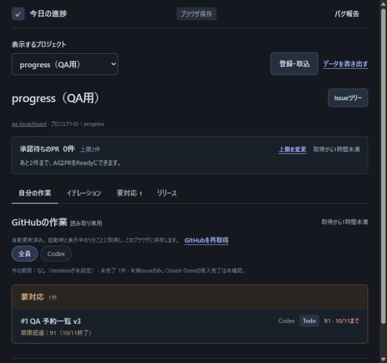
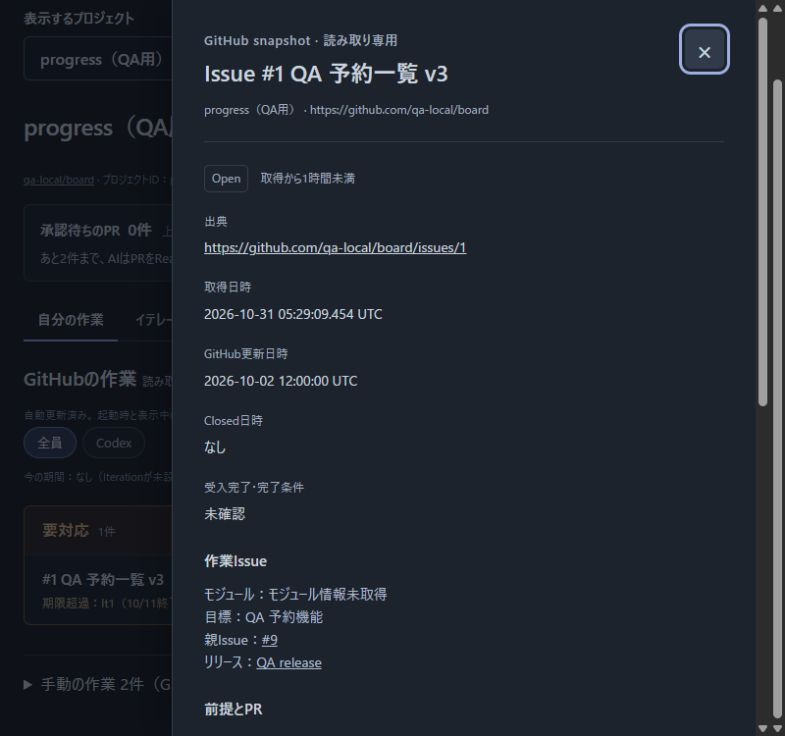
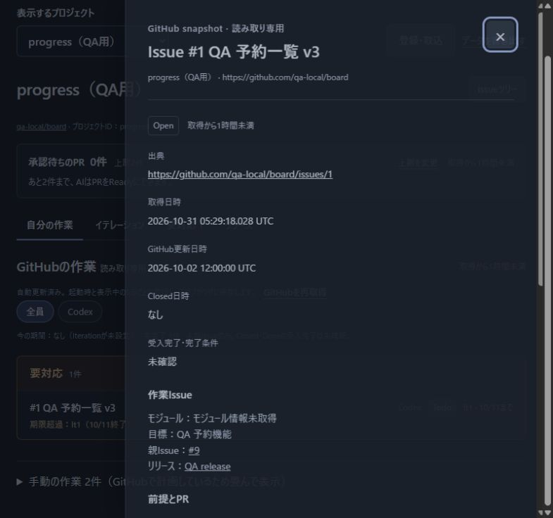
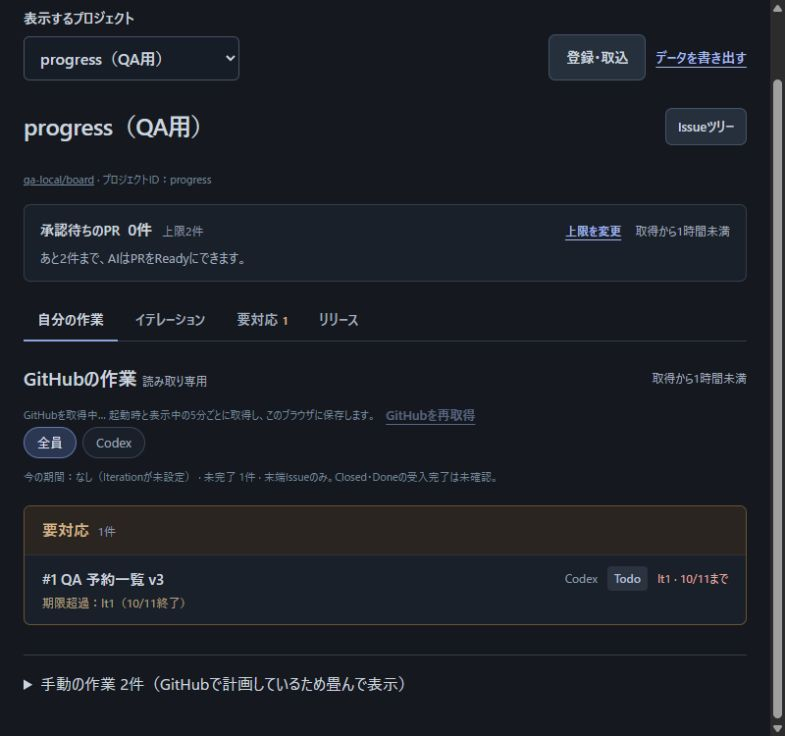
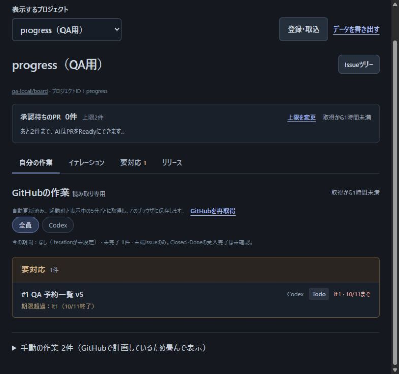
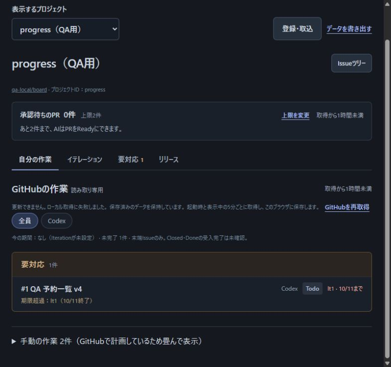
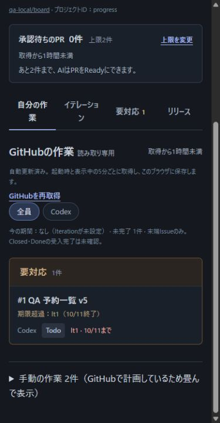
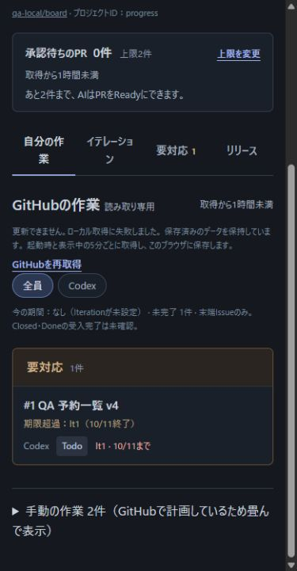

# ガント情報の取得と既存画面の比較記録

PR #137の確認者が、追加取得による既存画面と保存への影響を追うための記録である。
取得・保存の仕様は[取得手順](github-integration.md#ガント情報の取得と保存)、提出版の判定は[PR #137](https://github.com/Wakua/github-progress-board/pull/137)のUIレビューを参照する。
実利用者の行動観察とHosted本番の確認は含まない。

## 比較条件

2026-10-31、Codexがブラウザで実操作した。
変更前はmain `8c351f8c0e0262c3f067dbf87d320f8651b79d43`、変更後の製品コードは `ab3c78de42ec5345a772cbe32e12a53042e38590`。
この記録と検証用サーバー・画像の追加では製品コードを変更していない。

- サーバー: `tests/github-schedule-review-server.mjs`。
  変更前は第3引数にmainの展開先を渡した。
- データ: `tests/github-schedule-fixture.mjs` と `tests/local-github-fixture.mjs` の架空データ。
  外部の前提が1件ある作業と、その親、手動の作業2件を表示した。
- 接続: 変更前は `127.0.0.1:4387`、変更後は `127.0.0.1:4386`。
  GitHub応答だけを差し替え、各版の実際のserver・取得処理・保存処理・画面を使用した。
- 寸法: 両方とも800×750、狭い画面は390×750。
  スクロールバーを除くDOM幅はそれぞれ785、375。
- 撮影: 同じ応答設定・版番号・操作で比較した。
  取得時刻には実行時刻の差がある。

## 利用者の判断と操作

| 知りたいこと | 画面で判断する情報 | 次の操作 |
| --- | --- | --- |
| 取得が終わったか | GitHubの作業の取得中・更新済み表示 | 一覧から作業を開く |
| 取得できなかった後も作業を確認できるか | 失敗と保存済みデータ保持の文、残っている作業名 | 詳細を開く、再取得する |
| 作業の前提と計画は何か | 詳細の前提リンク、担当、Status、Estimate、Iteration | 詳細を閉じて一覧へ戻る |

上表は画面と実操作に基づく担当者の整理であり、実利用者が同じように判断したという観察結果ではない。

## 操作と結果

1. 旧形式のsnapshotを用意して起動し、成功応答で自動更新した。
   両版で作業名v3、担当・状態・Iteration、要対応1件が一致した（画像01）。
2. 作業名のボタンをEnterで開いた。
   両版で前提リンクとProjectの各値を表示した（画像02）。
   Escapeで閉じると元の作業名ボタンへフォーカスが戻った。
3. 応答を待機、版をv4にして「GitHubを再取得」を押した。
   両版で「GitHubを取得中…」となり、再取得ボタンは無効になった（画像03）。
   その間もv3の詳細を開けた。
   成功応答へ戻すと、開いた詳細を保ったままv4に更新した。
4. 外部前提だけを権限不足の応答、版をv5にして再取得した。
   mainは外部詳細を取得せずv5を保存した。
   PR版は追加取得に失敗し、既存の失敗表示とv4の一覧を残した（画像04）。
   PR版のworkspace・snapshot・手動の作業のSHA-256は、操作3の成功時から変わらなかった。
5. 幅390で同じ状態を開いた。
   再読込み後もPR版はv4を保持した（画像05）。
   両版ともDOMのscrollWidthとclientWidthは375で、横へのはみ出しはなかった。
   縦にスクロールして失敗表示、再取得ボタン、作業名を確認した。
6. 成功応答に戻し、再取得ボタンをEnterで押した。
   両版でv5を保存し、PR版にはscheduleが含まれた。
   手動の作業のハッシュは変わらなかった。
7. 取得全体を失敗させて再取得した。
   両版で既存の認証・読み取り許可の案内を表示し、操作6の保存データ全体を保持した。

### 保存保持の照合

検証用 `/qa` の「保存データを確認」で、ブラウザに保存した値のハッシュを表示して比較した。
外部前提の失敗前後で、PR版の次の値が一致した。

| 対象 | SHA-256 |
| --- | --- |
| workspace全体 | `1d34b986355183793d7c6de9d4035ae00f5cf295093c9a9a8ece2dde9dd3e0b9` |
| GitHub snapshot | `5329775027b4cb92fe9cf05bf2d6a25538b646f0a2edc9b687fcc82fe8c706cf` |
| 手動の作業 | `4292b2c1ddef7b68d03a618a54433d43764864ec4c2c1087cc0f84af955cdde0` |

snapshotの取得日時は失敗前後とも `2026-10-31T05:29:37.425Z`。
復旧後は `2026-10-31T05:30:06.781Z` へ更新された。

## 比較画像

各画像は[保存の規則](screenshots.md)に従い、PR本文にも同じファイルを掲載する。
既存の配置・常設説明・詳細項目を増減していない。
確認した変更は、追加取得の失敗が既存の失敗表示へ到達し、古い一覧を保持する状態の変化である。

### 更新成功（画像01）

### 詳細（画像02）

### 取得中（画像03）

### 外部前提の取得失敗（画像04）

### 狭い画面（画像05）

## 確認の限界

操作は担当者がfixtureで行ったもので、利用者による理解・採用判断やWCAG全体の確認ではない。
外部Issueの実アカウント権限不足は再現せず、GraphQLの権限不足応答を検証用サーバーで返した。
Hosted本番への保存と、日程を表示する後続画面への接続は未確認である。
