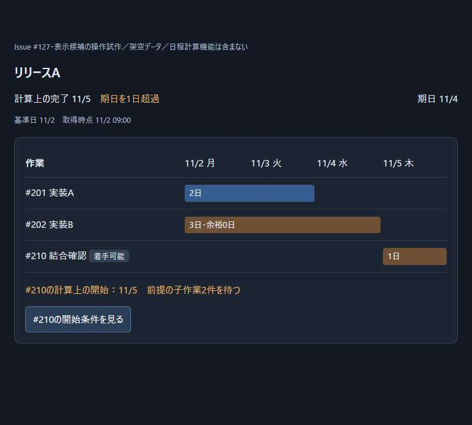
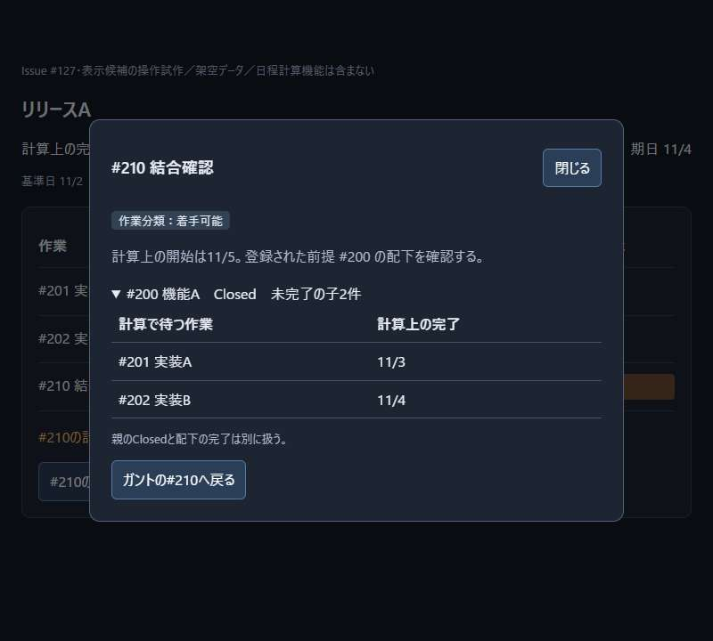
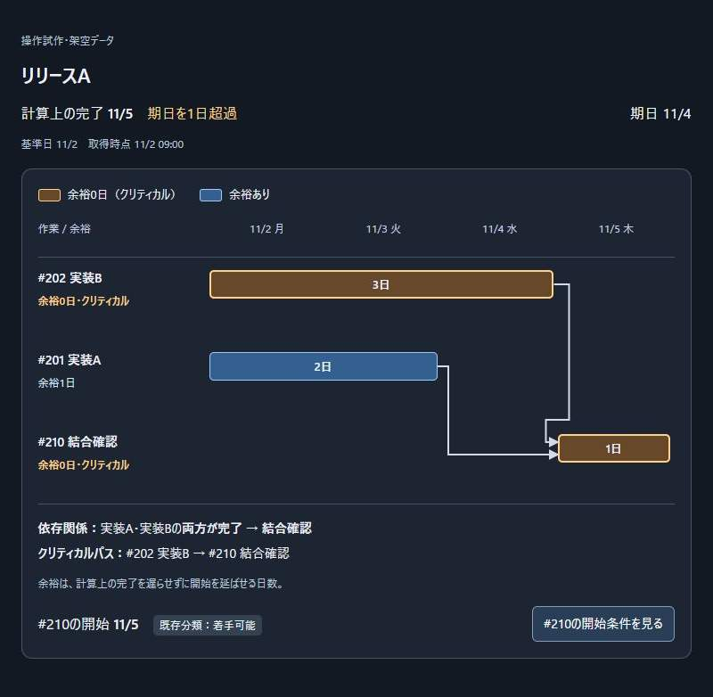
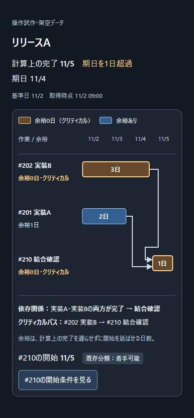
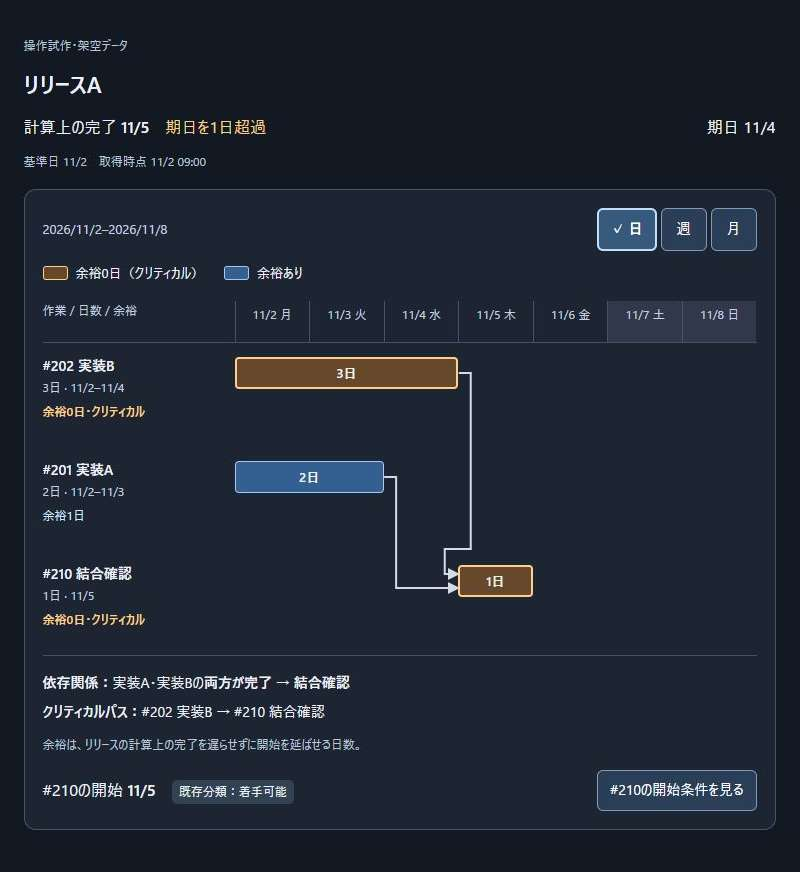
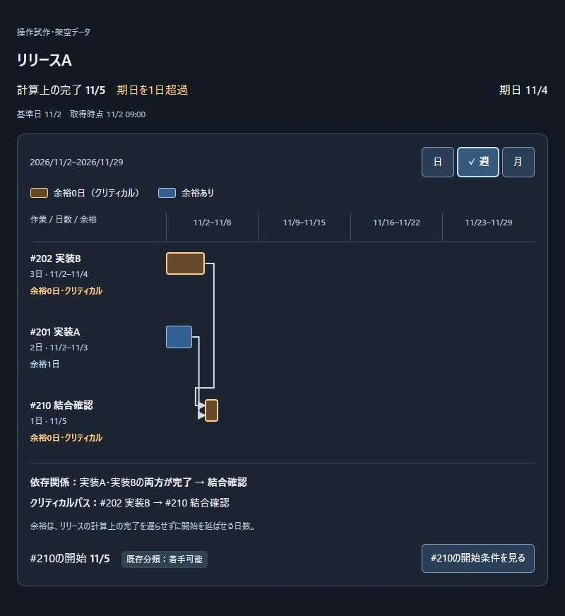
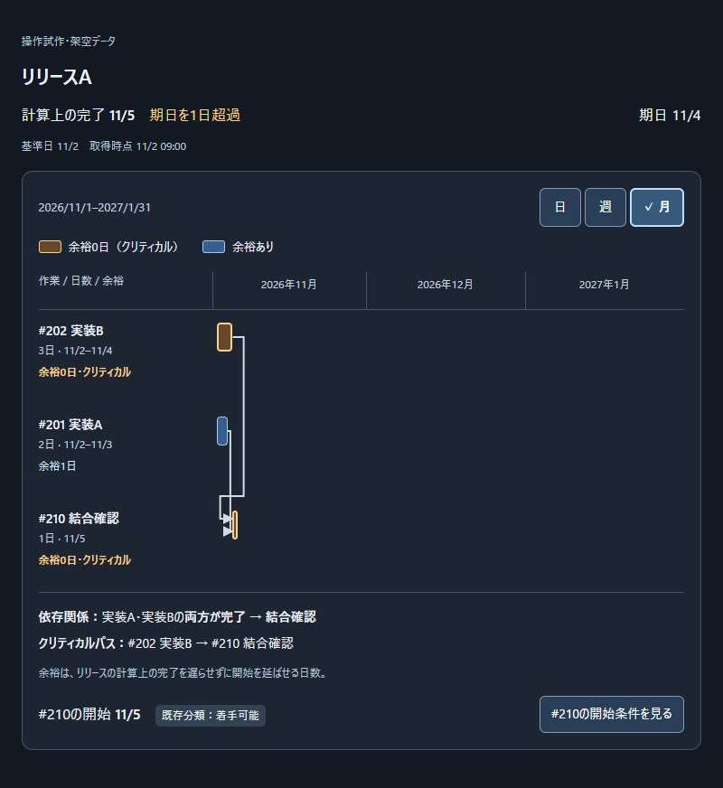
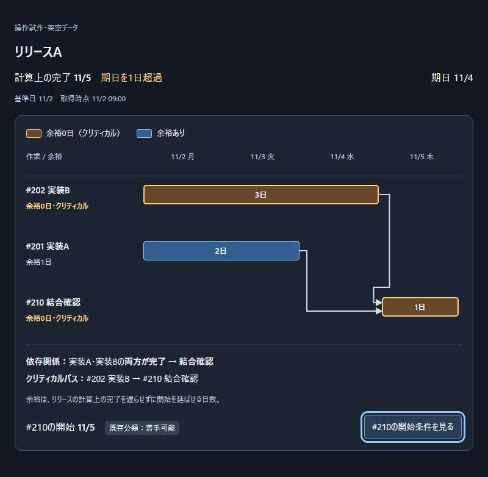
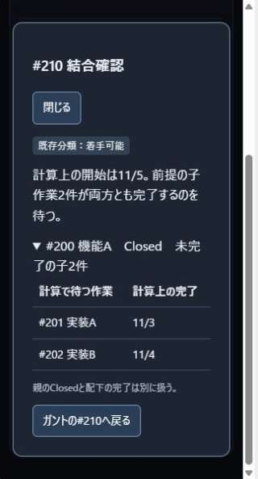
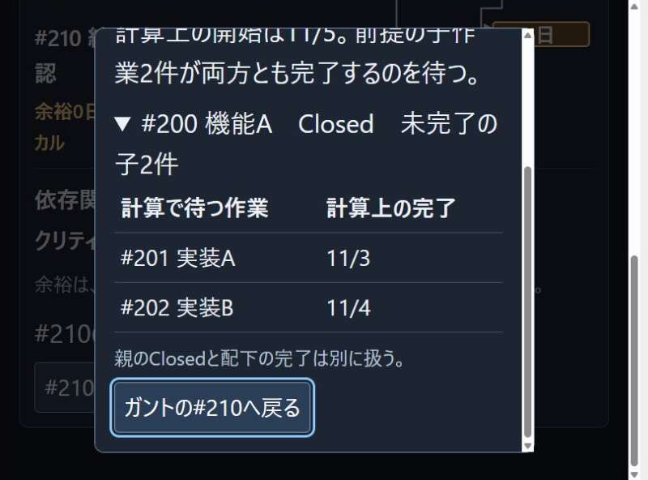

# ガントチャートの画面検討

画面の設計・実装担当者向けに、公開デモの観察と、開始条件を確認する表示候補をまとめる。
[Issue #127](https://github.com/Wakua/github-progress-board/issues/127)で扱う検討資料であり、画面全体の構造や操作を確定するものではない。
採用済みの動作と計算条件は[マイルストーンのガントチャート](milestone-gantt.md)を正本とする。

## 確認事実

2026-10-30にChromeでB1〜G1、アプリ内ブラウザでF1を確認した。
下表の「実操作」はCodexが公開デモを操作した記録であり、実利用者の行動観察ではない。
他社サービスの画像は`references/127-gantt-ui/`に保存し、Git管理の対象外とする。

| 記録 | 種別・出典 | 手順・時刻 | 確認した表示と操作 |
| --- | --- | --- | --- |
| B1 | 実操作：[Bryntum Advanced demo](https://bryntum.com/products/gantt/examples/advanced/) | `Zoom to fit` → `Run tests`のバーをダブルクリック → `Predecessors` → `Successors` → `Cancel` | 全期間へ縮小でき、選んだ作業の詳細を開けた。前提3件と後続1件は別タブの一覧で確認できた。依存先そのものへの移動は未確認 |
| B2 | 実操作：[Bryntum Critical paths demo](https://bryntum.com/products/gantt/examples/criticalpaths/) | `Highlight Critical Paths`をオフにして比較 | オンでは該当する行の背景とバーが赤く、オフでは通常の色に戻った。日付の列と時間軸を同じ画面に表示していた |
| B3 | 実操作：[Bryntum Advanced demo](https://bryntum.com/products/gantt/examples/advanced/) | 作業詳細を閉じ、`Resources`を選ぶ | 担当者や資源の一覧へ切り替わった。重複する作業や期間の警告は、この操作では確認できなかった |
| G1 | 提供元の操作動画：[Ganttifyの依存関係](https://help.gantt-chart.com/article/dependencies-in-todoist/)、[Vimeo](https://vimeo.com/358084394) | 埋込み動画を再生。00:34のメニューと00:45の接続後を確認 | 00:34では作業の右クリックメニューに`add dependency`があり、00:45では前後のバーを結ぶ線を確認できた。動画内の操作であり、Ganttifyを直接操作した記録ではない |
| F1 | 実操作：[Frappe Gantt公式デモ](https://frappe.io/gantt)の`Flexible timelines` | アプリ内ブラウザで`Day`→`Week`→`Month`を選択 | 日付、週の期間、年月へ目盛りが変わり、同じ4作業と依存線が縮尺に合わせて表示された。月表示では短い棒の横に作業名が残った。画像は`scale-demo-day.png`、`scale-demo-week.png`、`scale-demo-month.png`に保存 |

B1の開始画面では時間軸の後半が画面外にあり、全期間表示への操作が必要だった。
全期間へ縮小すると短いバーも小さくなるため、一覧から対象を見失わずに詳細へ進めるかは、対象件数を増やして確認する必要がある。
B2の色の切替だけでは、色を区別しにくい場合にクリティカルパスが分かるとは確認できない。

## 行動の整理

以下は利用者の判断についての仮説であり、実利用者に確認した結果ではない。
観察できた操作と、要件から必要になる確認を分けて示す。

| 知りたいこと | どこを見る → 何を判断する → 次の操作 | 根拠と未確認の範囲 |
| --- | --- | --- |
| この作業は何を待つか | 対象行の開始条件 → どの前提が開始を遅らせるか → 前提の一覧を開く | B1の作業から前提一覧へ進む操作を参考にする。集約Issueの展開は他社デモで未確認 |
| 遅れはどこへ影響するか | 選んだ作業の後続 → 影響する作業 → 後続を選び、その前提を確認する | B1・G1で前後の関係の表示を確認した。選択作業から連続して追う操作は候補 |
| 期日に間に合うか | マイルストーンの完了見込みと期日差 → 優先する作業 → クリティカルパス上の作業を開く | B2で強調の切替を確認した。期日との差を判断する操作は未確認 |
| 担当を見直すか | 重複の警告 → 同じ担当のどの作業・期間が重なるか → 対象作業を開く | B3は担当一覧の確認にとどまる。重複から作業へ進む操作は未確認 |
| 何を入力すれば計算できるか | 未算出の理由 → 不足した項目と対象Issue → 対象の詳細またはGitHubを開く | [情報不足と不整合](milestone-gantt.md#情報不足と不整合)から必要になる確認。参考ツールでの操作は未確認 |
| 月全体・週ごとの流れ・特定の日を見たい | 表示単位と期間 → 必要な細かさ → 月・週・日を切り替えて同じ作業を確認する | F1で単位、目盛り、縮尺の連動を確認した。利用者が目的に合う単位を選べるかは未確認 |

## 開始条件の表示候補

[既存の作業分類](specification.md#githubから表示する計画)と、[日程に使う前提](milestone-gantt.md#計算する作業と依存関係)が異なる場合の表示を検討する。
Closedの親を前提に持ち、配下には未完了の作業があるケースを対象とする。

| 候補 | 表示と操作 | 利点 | 懸念 |
| --- | --- | --- | --- |
| A：違いがある行に開始条件を添える | 既存の分類とともに「前提の子作業2件を待つ」などの短い理由を表示し、選ぶと前提の内訳を開く | 「着手可能」だけを見て日程上もすぐ始められると判断することを避けやすい | 該当する行が多いと情報量が増える。理由の置き方と長さは確認が必要 |
| B：違いを詳細にまとめる | 一覧は作業と日程を中心にし、詳細に既存分類と開始条件を並べる | 一覧に載せる情報を抑えられる | 詳細を開くまで違いに気づかないおそれがある |

Aを小さな操作試作の対象とした。
採用は未決定であり、両方の表示から利用者が開始条件を誤解せず説明できるか確認して選ぶ。
本番への反映時は、リリース画面と作業詳細が変更対象になる。

開始条件の詳細では、登録された前提、途中の集約Issue、展開後に待つ最下位の作業、各作業の計算上の完了または不足理由をたどれる候補とする。
親のClosedを配下の作業の完了と見なした表示にしない。
計算結果に必要な出典と経路を含められるかは、日程計算の仕様検討と合わせて確認する。

## 小さな操作試作

[操作試作](prototypes/milestone-gantt.html)は、候補Aを確認するための架空データのHTMLである。
日程は固定表示であり、計算機能、GitHubへの接続、製品への組込みは含まない。
月・週・日の切替では、この固定日程を別の縮尺で描き直す。
HTMLをブラウザで開くと、日程の表示と開始条件の確認を試せる。
検討用サーバーでは`http://127.0.0.1:4391/`で同じHTMLを表示する。

親`#200`がClosed、子`#201`と`#202`が未完了、後続`#210`の既存分類が「着手可能」というケースを使った。
操作は「#210の開始条件を見る」→「#200 機能A」を展開→子2件の計算上の完了を確認→「ガントの#210へ戻る」とした。
Chromeの実操作で、詳細が開くこと、親の下に子2件が表示されること、戻ると元の開始条件ボタンにフォーカスが戻ることを確認した。
画像は`14-prototype-before.jpg`、`15-prototype-details.jpg`、`16-prototype-expanded.jpg`、`17-prototype-return.jpg`に記録した。

以下は初回の試作をEdgeの検証用ブラウザで操作し、幅800ピクセルで撮った操作前後の画像である。
詳細の表示、子の展開、元のボタンへのフォーカスの復帰を再確認した。
製品の変更前後を示す画像ではない。

試作では違いを表示して開けることを確認しただけであり、利用者が迷わず判断できたとは扱わない。

### 色と依存関係の修正

初回の試作に対し、Wakuaから「色の違いがわからない」「どこに依存関係があるかわからない」と指摘を受けた。
当時の画面には色の凡例がなく、作業の棒を結ぶ依存矢印もなかった。
指摘は利用者の申告として扱い、操作過程を観察した記録とは区別する。

修正版には、棒の色の凡例、各作業の余裕日数、前提の完了から後続の開始へ向かう矢印を加えた。
この例の2本の依存関係とクリティカルパスは、色を見分けなくても確認できるよう、作業名を使って併記した。
余裕と期日差を混同しないよう、余裕の意味を短く示した。
矢印が別の作業の棒を横切らないよう、独立した前提2件の表示順を入れ替えた。

以下はアプリ内ブラウザで表示した幅800ピクセルの試作領域である。
表示後の画面から余白だけを切り取り、縮小せずに保存した。
詳細の表示、子作業の展開、元のボタンへのフォーカス復帰を再確認した。

同じHTMLの表示領域を390ピクセルに制限し、文字と矢印の欠け、および領域内の横方向へのはみ出しがないことを確認した。
端末のビューポート変更や実機での確認とは区別する。
修正版を利用者が読み取れるかは未確認であり、この表示を採用済みとは扱わない。

### 表示単位の切替

Wakuaから、月・週・日へ切り替えられないとの指摘を受けた。
固定の4日間だけを表示しており、表示単位を変える操作が要件と試作から漏れていた。
要件は[時間軸の表示単位](milestone-gantt.md#時間軸の表示単位)に定義した。

F1を参考に、時間軸の上に日・週・月のボタンと表示期間を置いた。
選択中の単位はチェック印と枠、支援技術へ伝える状態で示す。
切替時は同じ作業のある期間を表示し、縮尺に合わせて棒と依存線を描き直す。
月・週表示の短い棒に日数を詰め込まず、作業名の側に日数と開始・完了を残す。
狭い画面では時間軸の領域を横にスクロールでき、作業名の列は固定する。

この試作では初期表示を日、週の開始を月曜とし、日表示は1週間、週表示は4週間、月表示は3か月を表示する。
月の幅は暦日数に比例させ、日表示の土日には曜日と背景を付ける。
これらの初期値と表示期間は試作の条件であり、製品全体の既定値としては未決定である。

## UI/UXレビュー

### 確認範囲

2026-10-30に、PR #130の`6a1a83f`時点の試作を点検し、同PR内の修正後に再確認した。
`2d0bfe2`に対する表示単位の指摘も反映し、月・週・日の切替後に再確認した。
対象は、この文書の架空データ3作業と、表示単位を切り替える、開始条件を開く、親を展開する、元の作業へ戻る操作である。
計算機能や製品の画面全体のレビューではない。

[共通資料の配置先](development.md#uiuxレビュー)のREADME、01・02・03を読み、下表の節の問いを適用した。
04の「ユーザビリティテストの課題設計」「観察と誘導の区別」は、操作確認と利用者の理解を区別し、残る確認を整理するために参照した。
05・06は文言と日程表示に関係する節を参照した。
下表の01〜06は、共通資料のファイル名の先頭番号を表す。

確認にはアプリ内ブラウザを使った。
通常表示に加え、同じHTMLを幅800・320、高さ600 CSSピクセルのiframeで表示した。
縦スクロールバーを除く内容幅は、それぞれ785・305ピクセルだった。
文字拡大は幅800のiframeで各要素の文字サイズを200%にした確認であり、ブラウザのズーム操作とは区別する。
ローカルの操作画像と計測値は`references/127-gantt-ui/review-*`に保存した。

| 参照した節と確認する問い | 実画面の根拠・結果 |
| --- | --- |
| 01「システム状態の可視性とフィードバック」、02「視覚的な階層」：期日と見込みの違いを見つけられるか | 上部に計算上の完了11/5、期日11/4、1日超過を並べた。基準日・取得時点も表示し、実績の完了と混同しない表記を確認した。利用者が優先して見るかは未確認 |
| 01「再生より再認」、02「前注意的処理」、03「色に依存しない情報伝達」：色以外で意味を判断できるか | 凡例、各行の余裕日数、クリティカルの文字、作業名の経路表示を照合した。表示中の補足、警告、余裕、棒、分類、開始条件ボタンの文字色と背景色を計測し、最小の比は青い棒で5.86:1だった。色覚の実機評価ではない |
| 02「複数の表示の対応づけ」、06「グラフの選び方」「軸と目盛り」：何と何がつながり、日程をどう比較するか | 実装A・Bの各終端から結合確認の始端へ2本の矢印が向かう。AとBの間に依存線はない。文字の依存関係と一致し、クリティカルパスはB→結合確認だけである。等間隔の日付と3・2・1日の棒を照合した |
| 01「一貫性と標準」、02「操作部と結果の対応関係」、05「日付・数値・単位の表記」、06「比較を誤らせない表示」：単位を変えても同じ日程を追えるか | 日→週→月→日を操作し、チェック印・押下状態・表示期間・目盛り・棒と矢印が連動した。同じ3作業の開始・完了・日数、依存関係とクリティカルパスの文字は不変だった。月の目盛りでは2026年11月から2027年1月を確認した |
| 01「美的で最小限のデザイン」、02「段階的な情報開示」「メンタルモデル」：開始条件の根拠を必要なときに見られるか | 開始条件ボタンから詳細を開き、親#200を展開すると子#201・#202の完了見込みを確認できた。「既存分類：着手可能」と「計算上の開始11/5」は区別して表示した。情報量の妥当性と候補Bとの比較は未確認 |
| 05「リンクとボタンの文言」「専門用語の説明」、06「比較を誤らせない表示」：操作の結果と余裕の意味が一致するか | 開く・戻るボタンの対象と動作を照合した。余裕の説明には対象を補い、「リリースの計算上の完了」を遅らせない日数とした。期日差は上部に別表示した |
| 01「利用者の主導権と自由」、02「一覧と詳細の行き来」、03「キーボード操作とフォーカス」：開閉・展開・復帰をキーボードで行えるか | Tab・Enterで詳細と子一覧を開けた。修正後は詳細の先頭と末尾でTab・Shift+Tabが循環し、閉じる・戻る・Escapeの各経路で開始条件ボタンへ復帰した。アクセシビリティツリーに詳細名「#210 結合確認」が現れることも確認した |
| 03「操作対象の大きさ」：操作対象を見つけて押せるか | 開始条件ボタンの通常文字時の領域は約160×40 CSSピクセルだった。閉じるボタン、展開見出し、戻るボタンを実操作した。タッチ実機での押しやすさは未確認 |
| 03「拡大時の読みやすさ」：狭い画面や文字拡大でも情報と操作を失わないか | 幅800・320と幅800の文字200%で、文書全体に横方向のはみ出しがないことを計測した。狭い画面では時間軸だけを矢印キーで160ピクセル横に動かし、作業名が固定されることを確認した。文字200%でも週・月を切り替え、目盛りの文字が領域内に収まった。月表示から詳細を開いて戻っても、単位を保持した |

フォーム・入力エラー・認証・ドラッグ・非同期処理・検索・一括選択・保存と取り消しは、試作に該当する操作がないため対象外とした。
06の欠測値・割合と分母・不確かさの幅の表示は、固定日程の3作業に含まれず、製品への実装時に確認する。
05の日付・数値・単位は、同一月の固定日程と「日」の表記、年をまたぐ月の目盛りを確認した。
年越し作業や土日をまたぐ作業の計算結果との接続、地域・タイムゾーンの表示は未確認とする。

### 指摘と再確認

| 指摘 | 利用者への影響 | 修正と再確認 |
| --- | --- | --- |
| 詳細にアクセシブルな名前がなかった | 支援技術で、どの作業の詳細か識別しにくい | 見出しを`aria-labelledby`で関連付け、詳細名がアクセシビリティツリーに現れることを確認した |
| 詳細の末尾でTabを押すと、フォーカスがボタン群を離れた | 次の操作位置を見失うおそれがある | 先頭・末尾の移動を補い、TabとShift+Tabの循環、子の展開、3通りの閉じ方と復帰を再確認した |
| 余裕の説明に、どの完了を遅らせないかがなかった | 作業単体の完了や期日差と混同するおそれがある | 「リリースの計算上の完了」を補い、各行の余裕と上部の期日差を再照合した |
| 月・週・日への切替が要件と試作になかった | 広い期間と個々の日程を切り替えて確認できない | 要件と切替ボタンを追加した。クリックとTab・Spaceによる切替、選択状態、目盛り・縮尺・依存線の連動、詳細からの復帰を確認した |
| 週表示の短い棒で「1日」が縦にはみ出した | 棒の中の日数が読みにくくなる | 週・月表示では棒内の文字を出さず、作業名の側に日数と開始・完了を残した。3表示と文字200%で再確認した |

この3作業の表示候補について、共通資料に基づくレビューと上記指摘の再確認は完了した。
採用の判断や、製品全体の検証が完了したことは意味しない。
以下は修正後の画面であり、いずれも余白や検証用の操作部だけを切り取り、画像自体は縮小していない。
ここにある3枚は表示単位を追加する前の記録であり、追加後は[表示単位の切替](#表示単位の切替)の3枚を参照する。

### 未確認の範囲

ブラウザのズーム操作、スクリーンリーダーの実際の読み上げ、タッチ実機は、この検証環境では確認していない。
CSSによる文字拡大やアクセシビリティツリーの確認では代替できないため、製品への組込み後に対象ブラウザと支援技術で同じ操作を確認する。
WCAGへの適合は判定していない。

## 残る確認

- 利用者が、既存の「着手可能」と計算上の開始を区別して説明できるか。
- 中間の集約Issue、複数の前提、別repositoryの前提を含めても、元の依存関係を追えるか。
- 期日差、担当重複、情報不足・循環から、対象作業の詳細とGitHubへ進む操作。
- 修正した凡例・依存矢印・文字の経路表示を利用者が読み取れるか。
- 製品への組込み後のキーボード操作の全経路、狭いビューポート、多数の作業での確認。
- 候補Bとの比較と、一覧に常設する情報の範囲。

これらの確認前に、ガント画面全体の構造は確定しない。
実利用者の操作を観察していないため、開始日を判断する課題と、遅れが影響する作業を説明する課題で確認する。
操作場所を先に教えず、迷った箇所と判断理由を記録し、候補A・Bの採用判断へ使う。
