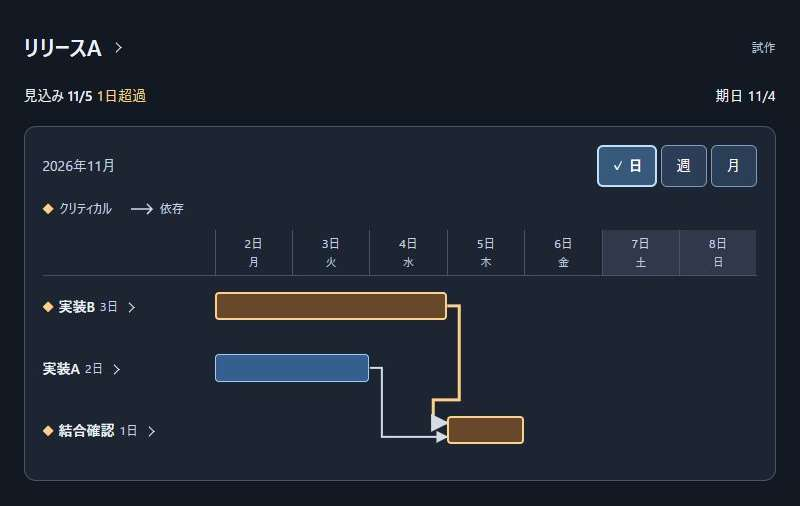
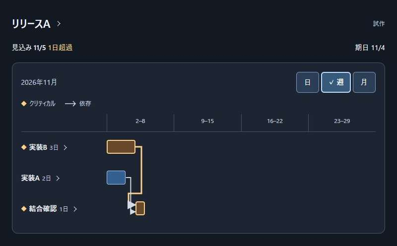
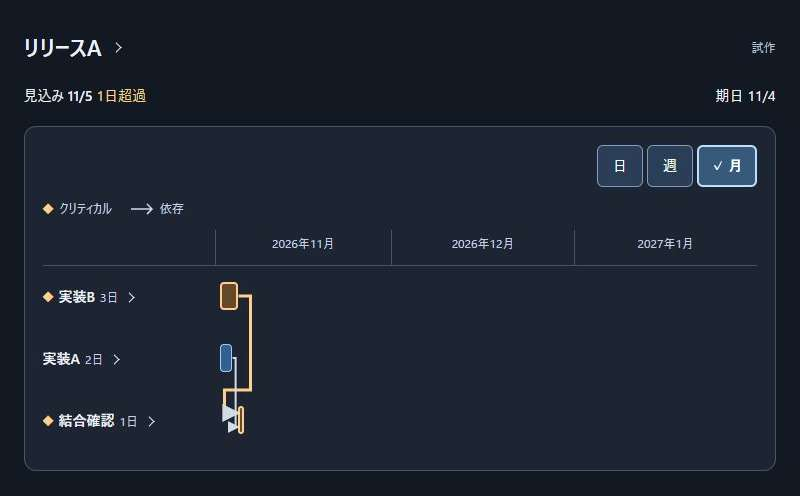
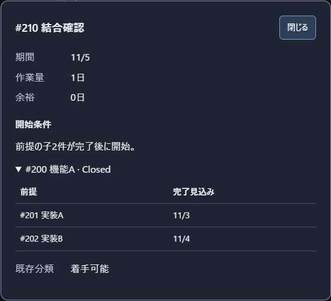

# ガントチャートの画面検討

画面の設計・実装担当者向けに、公開デモの観察、表示候補、現在の試作と確認結果をまとめる。
[Issue #127](https://github.com/Wakua/github-progress-board/issues/127)の検討資料であり、製品への採用は未決定である。
採用済みの動作と計算条件は[マイルストーンのガントチャート](milestone-gantt.md)を正本とする。

## 公開デモの観察

2026-10-30にChromeでB1〜G1、アプリ内ブラウザでF1を確認した。
「実操作」はCodexによる公開デモの操作であり、実利用者の行動観察ではない。
他社サービスの画像は`references/127-gantt-ui/`に保存し、Git管理の対象外とする。

| 記録 | 種別・出典 | 手順・時刻 | 確認したこと |
| --- | --- | --- | --- |
| B1 | 実操作：[Bryntum Advanced demo](https://bryntum.com/products/gantt/examples/advanced/) | `Zoom to fit` → `Run tests`のバーをダブルクリック → `Predecessors` → `Successors` → `Cancel` | 全期間の表示と、作業詳細の前提3件・後続1件を確認した。依存先そのものへの移動は未確認 |
| B2 | 実操作：[Bryntum Critical paths demo](https://bryntum.com/products/gantt/examples/criticalpaths/) | `Highlight Critical Paths`をオフにして比較 | オンでは該当する行とバーが赤く、オフでは通常の色に戻った。日付の列と時間軸を同時に表示していた |
| B3 | 実操作：[Bryntum Advanced demo](https://bryntum.com/products/gantt/examples/advanced/) | 作業詳細を閉じ、`Resources`を選ぶ | 担当者や資源の一覧へ切り替わった。重複する作業・期間の警告は確認できなかった |
| G1 | 提供元の操作動画：[Ganttifyの依存関係](https://help.gantt-chart.com/article/dependencies-in-todoist/)、[Vimeo](https://vimeo.com/358084394) | 埋込み動画の00:34と00:45を確認 | 00:34では右クリックメニューの`add dependency`、00:45では前後のバーを結ぶ線を確認した。Ganttifyの直接操作ではない |
| F1 | 実操作：[Frappe Gantt公式デモ](https://frappe.io/gantt)の`Flexible timelines` | `Day`→`Week`→`Month`を選択 | 目盛りと縮尺が変わり、同じ4作業と依存線が表示された。月表示でも棒の横に作業名が残った。画像は`scale-demo-day.png`、`scale-demo-week.png`、`scale-demo-month.png` |

B1では全期間へ縮小すると短い棒も小さくなった。
多数の作業で対象を追えるか、B2の色を区別しにくい場合にも意味が分かるかは、別途確認が必要である。

## 行動の整理

以下は利用者の判断についての仮説であり、実利用者に確認した結果ではない。

| 知りたいこと | どこを見る → 何を判断する → 次の操作 | 根拠・未確認の範囲 |
| --- | --- | --- |
| この作業は何を待つか | 対象作業と前提の線 → 開始を待たせる作業 → 作業の詳細を開く | B1を参考にする。集約Issueの展開は他社デモで未確認 |
| 遅れはどこへ影響するか | 後続へ向かう線 → 影響する作業 → 後続の詳細を開く | B1・G1で前後の関係を確認した。連続して追う操作は未確認 |
| 期日に間に合うか | 完了見込みと期日差 → 優先する作業 → クリティカルな作業の詳細を開く | B2で強調の切替を確認した。利用者の判断は未確認 |
| 担当を見直すか | 重複の警告 → 対象作業と期間 → 作業の詳細を開く | B3は担当一覧の確認にとどまる |
| 何を入力すれば計算できるか | 未算出の理由 → 不足項目と対象 → 詳細かGitHubを開く | [情報不足と不整合](milestone-gantt.md#情報不足と不整合)から必要になる確認。参考ツールでの操作は未確認 |
| 広い期間と個々の日程を見比べたい | 表示単位と期間 → 必要な細かさ → 日・週・月を切り替える | F1で目盛りと縮尺の連動を確認した。目的に合う単位を選べるかは未確認 |

## 開始条件の表示候補

[既存の作業分類](specification.md#githubから表示する計画)と、[日程に使う前提](milestone-gantt.md#計算する作業と依存関係)が異なる場合を検討する。
対象は、Closedの親を前提に持ち、その配下には未完了の作業があるケースである。

| 候補 | 表示と操作 | 利点 | 懸念 |
| --- | --- | --- | --- |
| A：一覧に開始条件を添える | 既存の分類と短い理由を表示し、選ぶと前提の内訳を開く | 日程上もすぐ始められるとの誤解を避けやすい | 該当する行が多いと情報量が増える |
| B：違いを詳細にまとめる | 一覧は作業と日程を中心にし、詳細に既存分類と開始条件を置く | 一覧に載せる情報を抑えられる | 詳細を開くまで違いに気づかないおそれがある |

現在の試作はBを基にする。
採用の判断には、利用者が開始条件を誤解せず説明できるかの確認が残る。

## 現在の試作

[操作試作](prototypes/milestone-gantt.html)は架空の3作業を使うHTMLである。
日程は固定であり、計算機能、GitHubへの接続、製品への組込みは含まない。
HTMLをブラウザで開くか、検討用サーバーの`http://127.0.0.1:4391/`で操作する。

| 見る場所・操作 | 表示する内容 |
| --- | --- |
| 一覧 | 完了見込み・期日差、作業名と日数、棒、2本の依存矢印。クリティカルは◆と短い凡例で示す |
| 作業名を選ぶ | 期間・作業量・余裕に加え、実装A/Bでは前提と後続、結合確認ではClosedの親と子2件、既存分類を表示する。子2件は最初から見える |
| リリース名を選ぶ | 計算の基準日、取得時点、余裕の意味 |
| 「閉じる」かEscape | 詳細を閉じ、開いた作業名またはリリース名へフォーカスを戻す |
| 日・週・月を選ぶ | 同じ固定日程を別の縮尺で表示する。日数は作業名の側だけに置く |

表示単位の要件は[時間軸の表示単位](milestone-gantt.md#時間軸の表示単位)に従う。
この試作では日を初期表示とし、日表示は月曜から1週間、週表示は月曜から4週間、月表示は月初から3か月とする。
月の幅は暦日数に比例させ、日表示の土日には曜日と背景を付ける。
これらは試作の条件であり、製品全体の既定値ではない。

## UI/UXレビュー

### 確認範囲

2026-10-31に、PR #130の`4a9e771`から文字量を削減した試作を確認した。
対象は3作業の一覧、各作業とリリースの詳細、日・週・月の切替である。
以下の実操作の結果は操作担当の確認記録に基づき、利用者の理解とは区別する。

[共通資料の配置先](development.md#uiuxレビュー)のREADME、01〜03と、変更に関係する04〜06の節を参照した。
下表の番号は共通資料のファイル名の先頭番号を表す。
04の「ユーザビリティテストの課題設計」「観察と誘導の区別」は、[未確認の範囲](#未確認の範囲)で行う利用者確認に使う。

フォーム、認証、ドラッグ、非同期処理、検索、一括選択、保存・取り消しは、該当する操作がないため対象外とする。
欠測値、割合と分母、不確かさの幅は固定データに含まれず、計算結果との接続時に確認する。

### 指摘

| 参照した節・確認する問い | 指摘・対応・再確認 |
| --- | --- |
| 01「美的で最小限のデザイン」、05「重複情報の整理」：今の判断に必要か、同じ説明を繰り返していないか | 利用者から文字量の多さを指摘された。凡例・各行・経路文による重複と説明の常設を削り、一覧を簡潔にした。`main.innerText`から空白を除いた文字数は、日表示で335文字から83文字になった。変更後の週表示は79文字、月表示は77文字である |
| 02「段階的な情報開示」「操作の手掛かりとシグニファイア」、05「リンクとボタンの文言」：詳細への入口と結果が対応するか | 個別の開始条件ボタンをなくし、全作業名とリリース名を入口にした。3作業それぞれの詳細と計算根拠を開けることを実操作で確認した。結合確認の前提2件は、詳細を開いた時点で見える |
| 02「前注意的処理」、03「色に依存しない情報伝達」、06「グラフの選び方」：色以外で意味と関係を伝えられるか | ◆と短い凡例、2本の依存矢印を残した。支援技術向けにも作業名、クリティカル、前後の関係を設定した。利用者がこれだけで読み取れるかは未確認 |
| 01「一貫性と標準」、06「軸と目盛り」「比較を誤らせない表示」：表示単位を変えても同じ日程を追えるか | 日・週・月を切り替え、3作業の日程と依存関係が保たれることを実操作で確認した。棒内の日数を削り、作業名の側に一度だけ表示した |
| 01「利用者の主導権と自由」、02「一覧と詳細の行き来」、03「キーボード操作とフォーカス」：詳細を閉じても操作を続けられるか | 「閉じる」とEscape、Tab・Shift+Tabによる詳細内の循環を実操作で確認した。閉じた後は各詳細を開いた入口へフォーカスが戻った |
| 03「拡大時の読みやすさ」「キーボード操作とフォーカス」：文字が欠けたり重なったりせず、必要な操作に到達できるか | 幅320ピクセルの埋め込み枠で、日・週・月の切替、時間軸のRightキー操作、3作業へのTab移動、結合確認の詳細とEscapeによる復帰を確認した。幅800ピクセル・文字200%（内容幅785ピクセル）では、切替、詳細の文字拡大、子2件のスクロール確認、元行への復帰を確認した。項目列を文字の大きさに合わせ、既存分類も崩れず読めた。両条件でページ全体の横方向へのはみ出しはなかった |

### 未確認の範囲

- ブラウザのズーム操作、スクリーンリーダーの実際の読み上げ、タッチ実機は未確認である。
  支援技術向けの属性だけで利用できるとは判断せず、製品への組込み後に対象環境で確認する。
- 実利用者の操作は観察していない。
  開始日を判断する課題と遅れの影響を説明する課題を、操作場所を教えずに行い、候補A・Bを比較する。
- 中間の集約Issue、外部の前提、多数の作業、担当重複、情報不足・循環、GitHubへの移動は今回の試作に含まない。
  計算結果との接続後に確認する。

画面全体の採用とWCAGへの適合は判定していない。
