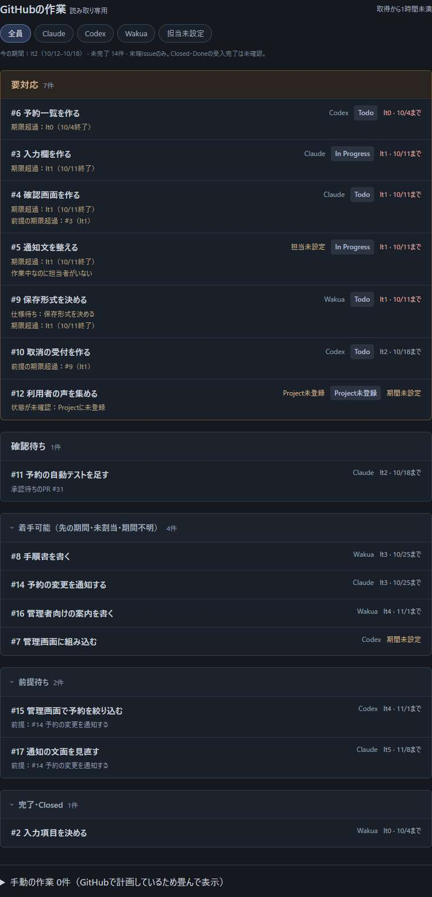
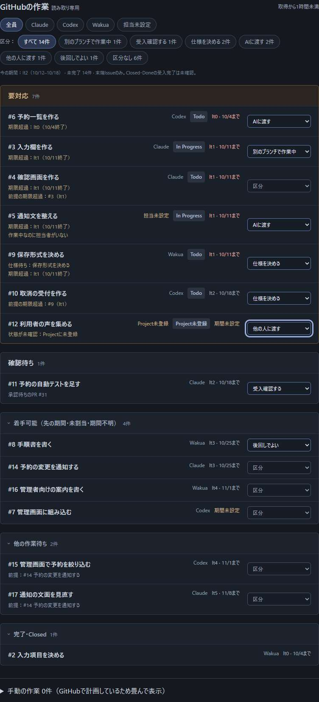
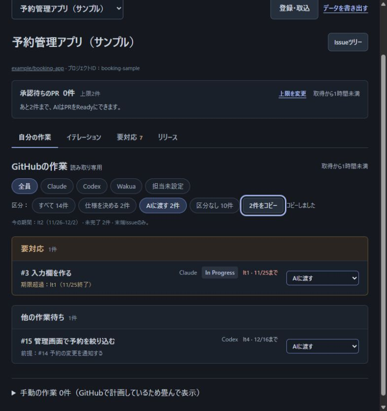
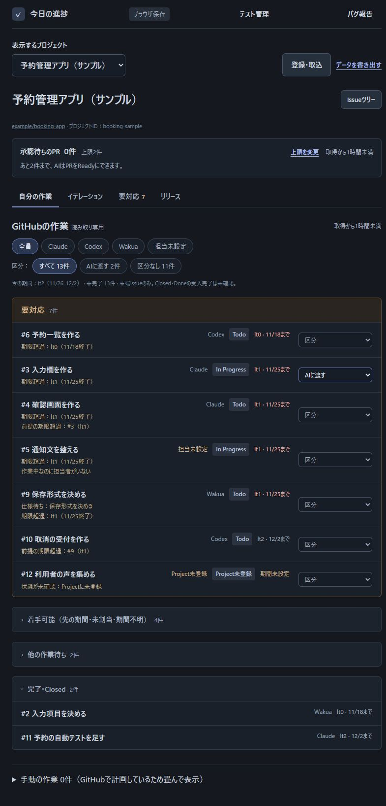
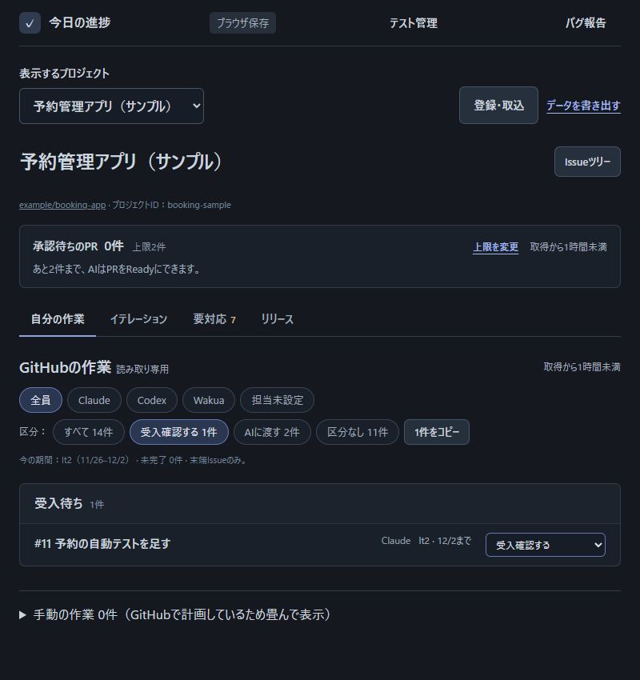
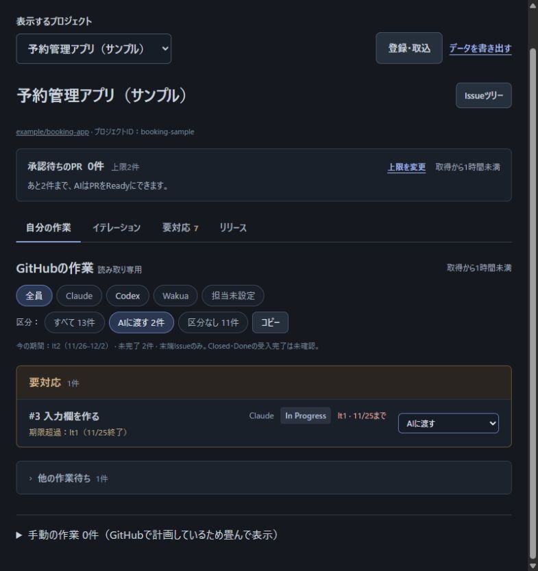
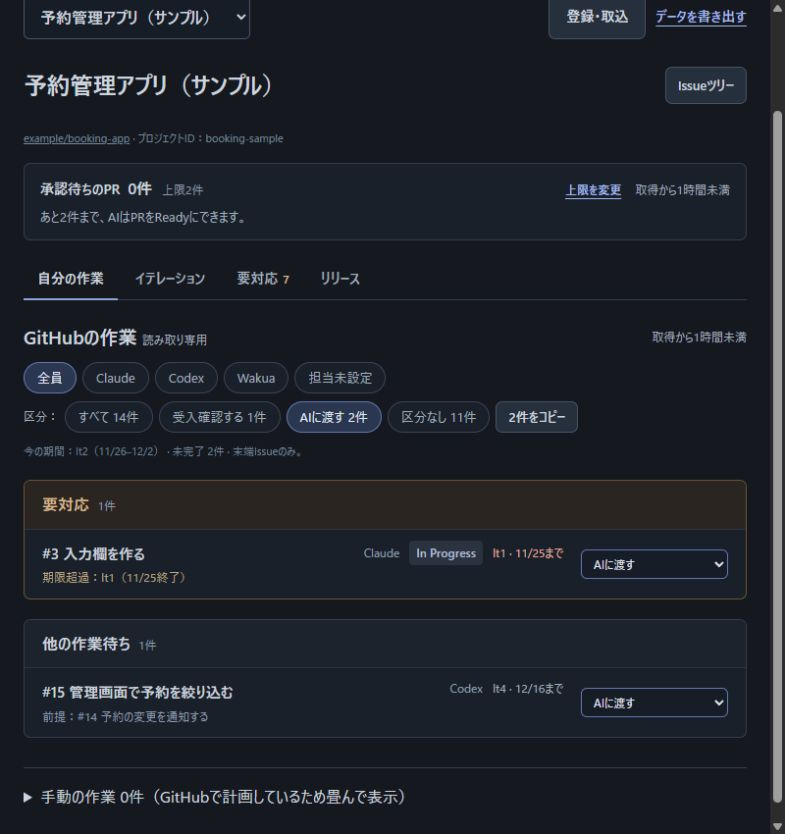
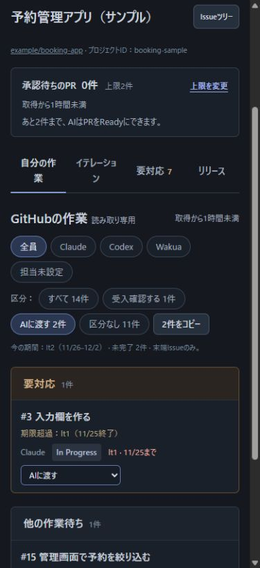

# 次にすることの区分の観察

[Issue #182](https://github.com/Wakua/github-progress-board/issues/182)で、一覧の作業に「次にすること」の区分を付ける画面を設計するために、現在の一覧の観察と行動の整理を記録する。
区分の規則は[次にすることの区分](specification.md#次にすることの区分)に定める。

## 観察

2026-11-25に、本ツールのローカル画面をClaudeが操作した。
変更前の出典はmainの `cb64e76` である。
データは `scripts/make-booking-sample.mjs` が作る架空の予約管理アプリで、画面の日付は2026-10-13に固定した。
実在のrepositoryのデータは使っていない。
この時点では、本ツールの操作だけを確認した。

| 操作 | 観察した事実 | 画像 |
| --- | --- | --- |
| 「自分の作業」を開く（全員） | 未完了14件が、要対応7件・確認待ち1件・着手可能4件（畳み）・他の作業待ち2件（畳み）に分かれる。完了・Closedは1件 | 下の変更前の画像 |
| 各行を見る | 作業名、理由、担当、期限が並ぶ。要対応の行だけStatusも出る。作業について人が決めた「次にすること」を示す欄はない | 同上 |
| 幅390ピクセルで開く | 行の情報が縦に並び、横のはみ出しはない | `screens/182/before-02-narrow.jpg` |

## 行動の整理

Issue #182の依頼を根拠に整理した。
Wakuaが挙げた区分の例は仮説であり、実利用者の操作としては確認していない。

| 知りたいこと | 見る情報 | 判断 | 次の操作 |
| --- | --- | --- | --- |
| 終わっているのに開いている作業はどれか | 状態、PR | Issueを閉じるか、確かめるか | 区分を付け、閉じる作業を集める |
| 自分が決めるべきことは何か | 仕様待ちの理由、題名 | 今決めるか、時期を決めるか、後回しにするか | 区分を付け、決める作業を集める |
| AIに渡せる作業はどれか | 前提、期限、題名 | 渡すか、他の人に渡すか | 区分を付け、AIへ渡す作業をまとめてコピーする |
| 実装が済んだ作業の受入はどれか | 状態、PR | 動作を確認して受け入れるか | 「受入確認する」を付け、確認する作業を集める |

## 設計

- 区分は作業の行に置く選択で付ける。
  一覧を見て気づいた順に付けられ、作業を開かずに済む。
- 絞り込みは担当者の絞り込みと同じボタンの形にする。
  区分を一つも付けていない間は表示せず、常設の説明文は足さない。
- コピーする文は、先頭に次にすることを置き、作業ごとに1行にする。
  根拠は、一覧の行に示す理由を再利用し、作業ごとの入力を増やさない。
- 区分の定義、保存先、判断待ちとの関係は[次にすることの区分](specification.md#次にすることの区分)に従う。

## 操作結果

変更前後の比較画像は、同じ架空データ、同じ幅800ピクセルで撮影した。
2026-11-25に、Chromeで区分の入力と絞り込みを確認した。
コピー操作の3枚は、2026-11-27に最新版の表示で撮り直した。
撮り直しには、下の受入待ちの確認と同じサンプルを使った。

| 確認した操作 | 結果 | 画像 |
| --- | --- | --- |
| 区分を付けていない一覧を開く | 区分の絞り込みは出ず、完了・Closedを除く各行に選択が出る | `screens/182/after-01-list.jpg` |
| 8件に区分を付ける | 作業の並びを保ったまま、選んだ区分が行に残り、「区分」のボタンに件数が出る | `screens/182/after-02-assigned.jpg` |
| 「AIに渡す」を選び、「2件をコピー」を押す | #3と#15を表示し、押すと「コピーしました」と出る | `screens/182/after-03-filter-ai-copy.jpg` |
| 「仕様を決める」を選び、「2件をコピー」を押す | #4と#9を表示し、押すと「コピーしました」と出る | `screens/182/after-04-filter-spec-copy.jpg` |
| 再読み込みする | GitHub snapshotと付けた区分を保持し、絞り込みは「すべて」に戻る | 画面操作で確認 |
| 区分を外す | 保存データから区分が消える | 画面操作で確認 |
| キーボードだけで、区分を選び、絞り込み、コピーする | TabとEnterで絞り込みから「N件をコピー」に移って操作できる | 画面操作で確認 |
| 幅390ピクセルで開く | 選択が行の下に回り、横のはみ出しがない | `screens/182/after-05-narrow-assigned.jpg`、`screens/182/after-06-narrow-filter-ai.jpg` |

## 受入待ちとコピー対象の確認

[Issue #183](https://github.com/Wakua/github-progress-board/issues/183)では、LinearとJiraを操作した。
GitHub Projectsは公式デモとCLIで確認し、ブラウザでの移動と一括更新は未確認として記録した。
複数件を操作する前に対象を特定できるよう、コピー前の一覧と件数を見直した。

PR #185の更新前の版 `f791ba4` と更新後の試作を、同じ予約管理のサンプルデータで確認した。
#11に受入待ちの記録を追加し、#3と#15には「AIに渡す」を付けた。

| 操作 | 変更前 | 変更後 |
| --- | --- | --- |
| #11に「受入確認する」を付ける | 「完了・Closed」を開いても区分の選択がない | 「完了・Closed」を開いて#11に区分を付けると、絞り込みで「受入待ち」に出る |
| 「AIに渡す」の2件を確かめる | #3は見えるが、#15は折りたたまれている | #3と#15が開いて表示され、ボタンに「2件をコピー」と出る |

コピーする文の作業と順序は、自動テストで画面に表示する行と一致することを確認した。

## レビュー指摘の再確認

- Closedのサンプル#2に受入待ちの記録を付けても、「未完了」は14件のままで、該当の作業は「完了・Closed」に畳まれた。
  開くと区分を付けられ、絞り込みでは「受入待ち」1件を表示した。
- 「AIに渡す」で絞り込み、最後の1件から区分を外すと「すべて」に戻った。
  別の作業に「AIに渡す」を付けても、一覧は「すべて」のままだった。
- ブラウザの保存ロックを保持している間は、一覧の区分の選択欄がすべて無効になった。
  ロックを解放して保存が終わると、区分を選べる状態に戻った。
- 「AIに渡す」で2件に絞り込み、1件の区分をキーボードで「仕様を決める」に変えると、その行が消えた。
  フォーカスは「AIに渡す 1件」のボタンへ移った。

## 未確認

- 実利用者が、区分の過不足を判断できるか。
- クラウドモードの共有保存での操作。
