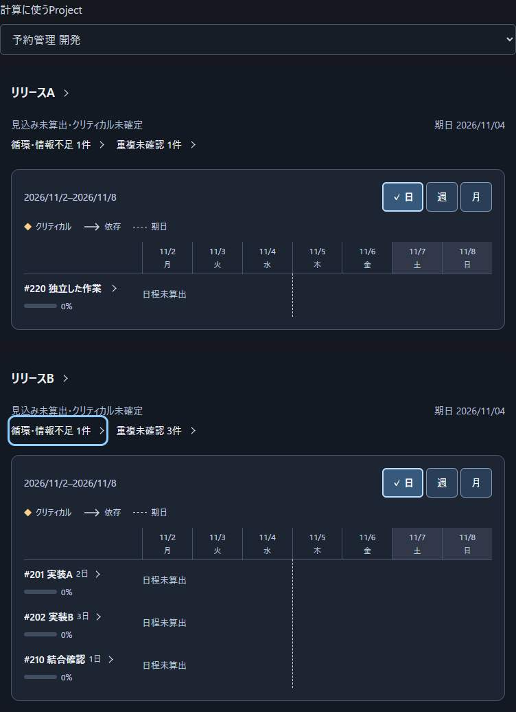
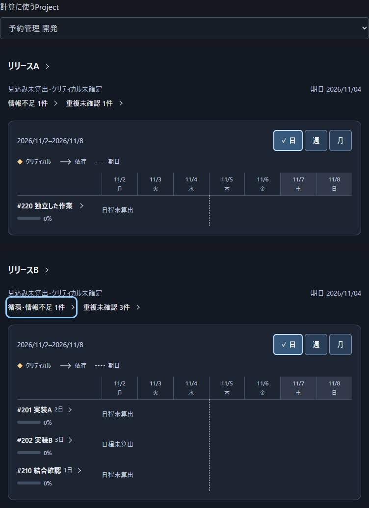

# リリースごとの循環警告の確認

対象は[Issue #128](https://github.com/Wakua/github-progress-board/issues/128)のリリース画面で、利用者が未入力の値と依存の循環を区別して、原因の詳細へ進めることを確認する。
比較元はmain `c7240860e2f19840ccc8b68681805f0da9b9d099`、修正案の `dist/gantt-chart.mjs` のblobは `9083c4692f995d6659c649cc89abcfa21443d894`。

## 再現と回帰確認

同じ架空のsnapshotに、Aの独立した見積未入力の作業と、Bの相互に依存する2作業・その後続を含めた。
通常の「リリース」タブで「予約管理 開発」を選択した。
修正前後で同じデータ、800px幅、同じ操作順を使った。

| リリース | mainの警告 | 修正後の警告 | 警告を開いて確認した原因 |
| --- | --- | --- | --- |
| A | 循環・情報不足 1件 | 情報不足 1件 | 独立した作業の見積が未入力 |
| B | 循環・情報不足 1件 | 循環・情報不足 1件 | 実装Aと実装Bの前提が循環 |

警告の件数と詳細は、もともと各リリースに関係する原因を使っていた。
修正では、警告名にも同じ原因の範囲を使う。
ある循環が実際に別リリースの作業に影響する場合は、そのリリースの原因に同じ循環のIDが含まれる。

## UIレビュー

| 問い | 判定 | 操作・結果 |
| --- | --- | --- |
| I1・I2 情報量 | 確認済み | 上の比較画像のとおり、Aから誤った「循環」の語だけを取り除いた。原因の件数と詳細への入口を保っている。 |
| J1・J2 判断の手掛かり | 確認済み | AとBの原因を文字で区別できる。320px幅で警告の文字をCSSで2倍にし、両方の警告名・件数が画面内に収まることを確認した。 |
| O1・O2 操作 | 確認済み | A・Bそれぞれで警告をEnterで開き、表示した原因を照合した。Escapeで閉じると、操作を始めた警告にフォーカスが戻った。 |

検証はCodexによる架空データのブラウザー操作である。
利用者本人が警告を読んで判断できるかは、R3の受入で確認する。

## 再実行

[ブラウザー検証の環境](../development.md#検証手順)で、`QA_BASE_URL`に対象版のローカルサーバーを指定し、`node tests/gantt-warning-browser-qa.mjs`を実行する。
同じ検査は`npm run test:browser`にも含まれる。
mainではAの警告名の照合に失敗し、修正案では両方の警告名と詳細が一致した。
