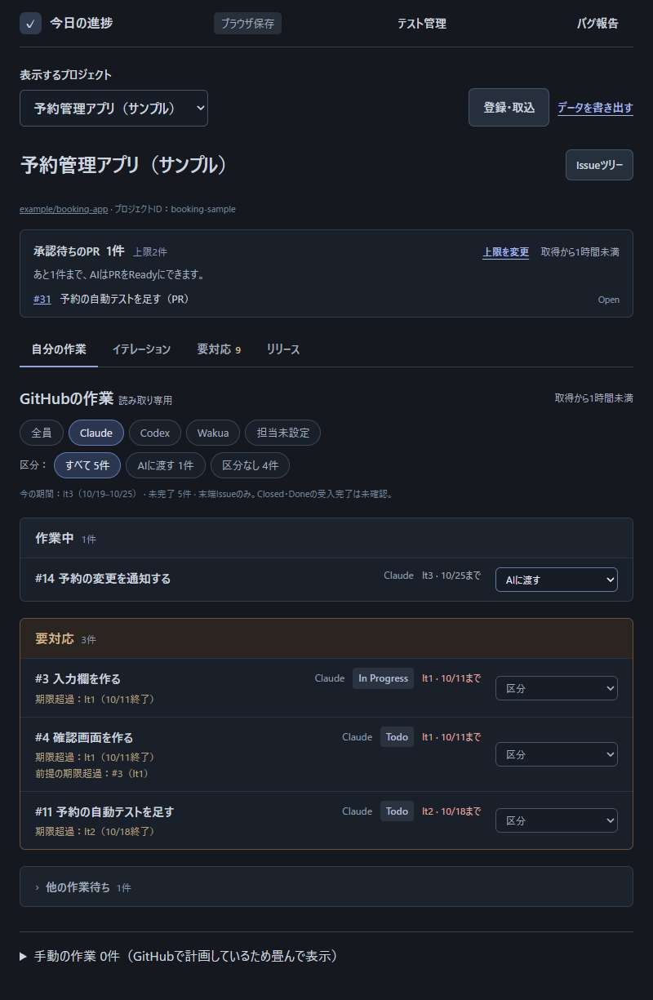
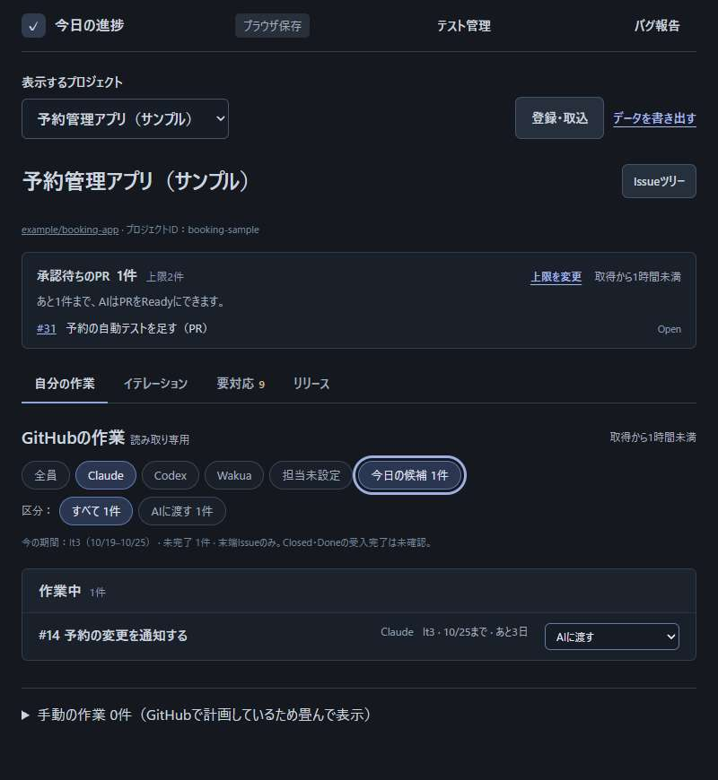

# #191 今日の候補の試作

## 対象

2026-11-28、Codexが変更前の main `62f3373` と試作ブランチ `codex/issue-191-today-candidates` をChromeで操作した。画面には架空の予約管理サンプルを使用した。

## 画面の比較

どちらも幅800ピクセル。画面の日付を10月22日に固定し、「自分の作業」でClaudeを選んだ。試作では続けて「今日の候補」を押した。

| 変更前 | 試作 |
| --- | --- |
|  |  |

| 操作 | 結果 |
| --- | --- |
| キーボードで「今日の候補」を選ぶ | Claudeの候補1件を表示し、ボタンにフォーカスが残った。解除後は担当者・区分の選択が残った。 |
| 区分「AIに渡す」で絞ってコピーする | 表示した #14 の1件をコピーした。別の担当や候補外の作業は含まれなかった。 |
| 期限を10月25日とし、10月21日・22日・25日・26日で開く | 作業中の #14 は、21日は候補外、22日は「あと3日」、25日は「今日まで」、26日は候補外で要対応に出た。 |
| 10月29日に #15 の前提を未完了・完了に切り替えて開く | 未完了では候補外、完了では着手可能として候補に入った。 |
| 「要対応」を開く | 変更前後でタブの件数と一覧が一致した。 |
| 幅390ピクセルで候補を開く | 期限が読め、横にはみ出さなかった。[画面](../screens/191/after-02-narrow.jpg) |

## 候補の件数

作業件数は末端Issueのうち、試作の「自分の作業」で未完了に分類された件数。実データは2026-11-28 14:37 JSTに取得した同リポジトリのGitHubデータを使い、画面と同じ判定で集計した。

| 確認範囲 | 対象の未完了作業 | 今日の候補 | 担当者別 |
| --- | ---: | ---: | --- |
| 開発の実データ | 34 | 3 | Codex 2、Claude 1、Wakua 0 |
| 着手可能な作業を3人に8件ずつ追加したサンプル | 38 | 26 | 選択したClaudeは9件 |

実データの候補3件は、すべて期限が近い作業中の項目だった。取得データを固定したまま日付だけを期限の3日前にすると、当日と同じ3件を確認できた。前日から表示する条件で数えると、その日は0件だった。サンプルのように着手可能な作業が集中すると、全員表示では26件になった。実利用で件数が多い日の選びやすさは未確認である。