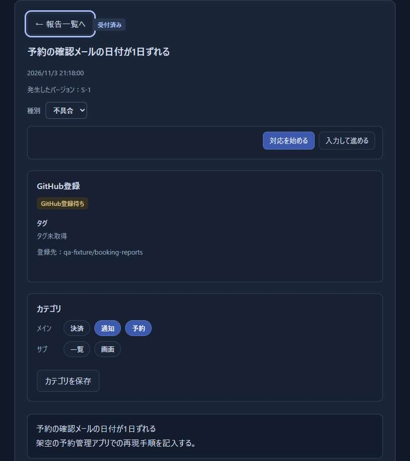
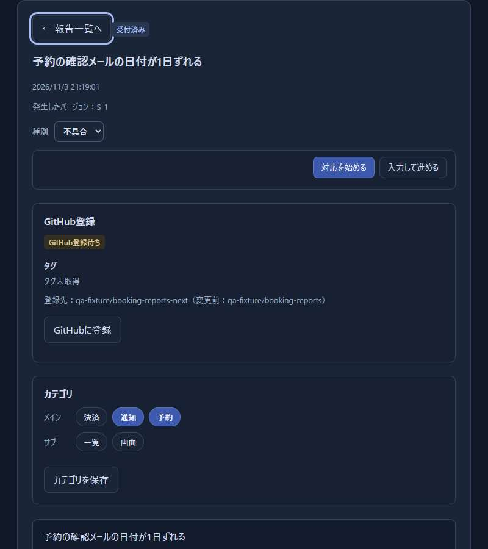
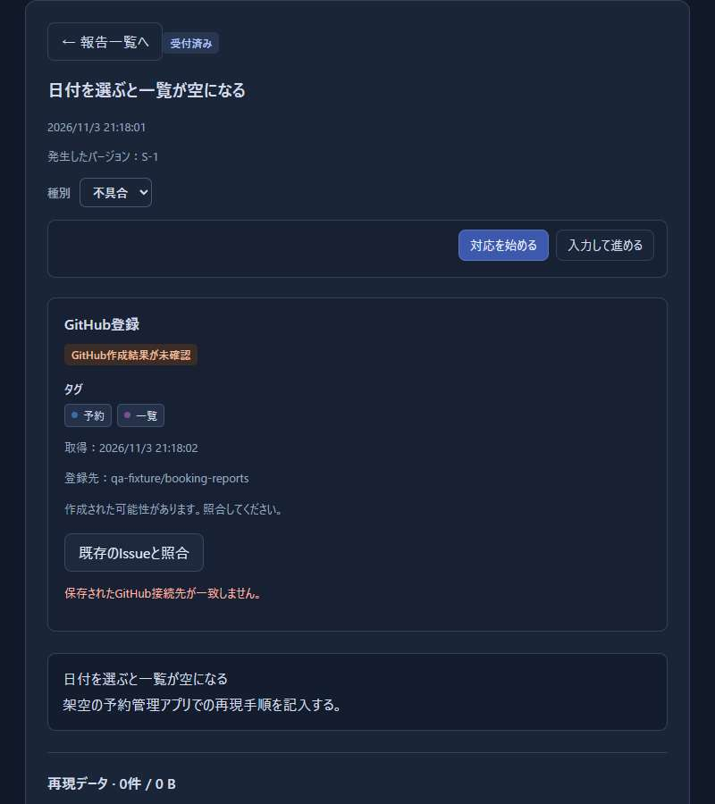
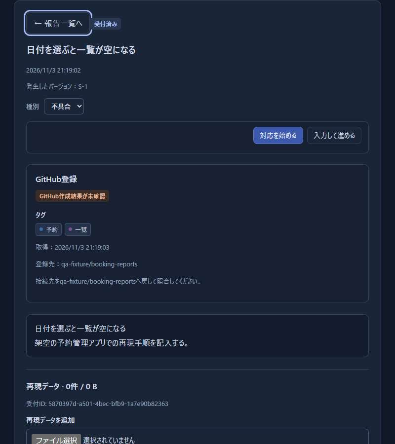
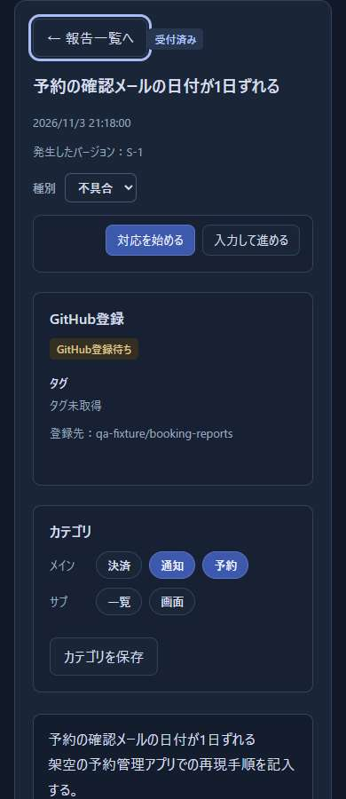
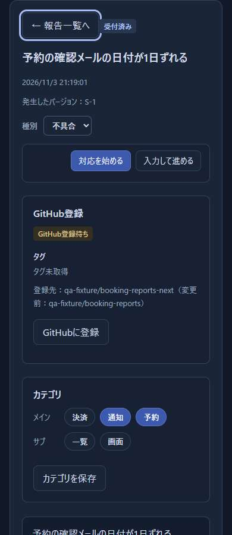
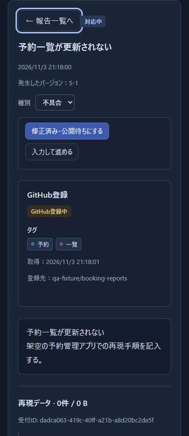
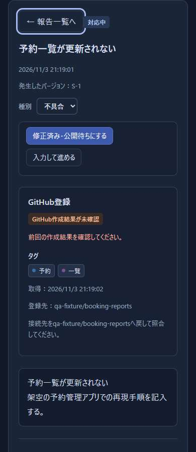
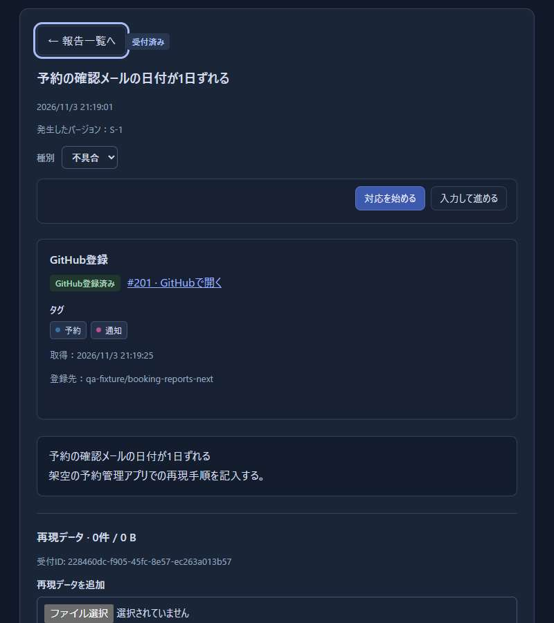

# 接続先変更後の報告の復旧

運用者とレビュー担当者が、[#56](https://github.com/Wakua/github-progress-board/issues/56)の復旧対象と重複を避ける条件を確認するための記録である。

## 対象と観察

- 比較元：`03ecc75482a2b842def096859cf9bc020adf5243`
- 実装・自己レビュー対象：`57f215c9425cb18307a16b01e56fcf93af1a3d5a`
- 実施者：Codex、2026-11-03（JST）
- 環境・結果：[検証データ](56-repository-recovery.json)

[共通の画面用データ](../../tests/bug-screens-server.mjs)にある架空の予約管理アプリの19報告を使った。
実在の報告やrepositoryは使っていない。
[復旧用fixture](../../tests/bug-repository-recovery-fixture.mjs)で登録待ち・作成中・結果未確認を用意し、DBを閉じ、模擬GitHubの接続先を変えてサーバーを再起動した。
変更前後のコードに同じ手順を適用した。

変更前の実画面で、登録待ちには登録ボタンがなく、作成中は再起動後も作成中に残ることを観察した。
結果未確認には照合ボタンがあるが、押すと「保存されたGitHub接続先が一致しません。」と表示された。
Codexによる操作と静止画の確認であり、利用者の行動観察や操作動画の観察ではない。

## 行動の整理と設計

| 利用者が判断すること | 観察した画面と不足 | 採用した変更 |
| --- | --- | --- |
| この報告をどこへ登録するか | 登録待ちは旧接続先だけを表示し、次の操作がない | 現在と変更前の接続先を表示し、手動の登録ボタンを置く |
| 途中で止まった登録をどう扱うか | 接続先変更後も作成中に残り、完了するか判断できない | 全接続先の作成中を結果未確認へ戻す |
| 結果未確認をどこで照合するか | 照合ボタンを押しても409になり、戻す手順が分からない | 元の接続先を示し、現在の接続先では照合・再試行を出さない |

利用者が上の情報から手順を選べるという点は設計上の仮説である。
動作の受入は、ユーザーの指示に従いリリース時に行う。
保存された接続先へ任意に接続する機能は加えていない。

登録待ちには、作成要求の後に利用制限で待機した報告もある。
送信記録がある登録待ちは接続先変更時に結果未確認へ戻し、手動付替えも拒否する。
元の接続先・識別子・作成要求の時刻を維持し、照合後に既存のIssueへ関連付けられるようにした。
同じ接続先の待機予定は変更しない。

## 比較画像

画像の操作手順は[ブラウザ検証](../../tests/bug-repository-recovery-browser-qa.mjs)から再実行できる。
幅800pxと390px、同じ19報告で比較した。

| 状態 | 変更前 | 変更後 |
| --- | --- | --- |
| 登録待ち・幅800px |  |  |
| 結果未確認・幅800px |  |  |
| 登録待ち・幅390px |  |  |
| 再起動後の作成中・幅390px |  |  |

登録後は、新しい接続先のIssueリンクと登録済みの状態を表示した。



## 検証と自己レビュー

| 検証 | 結果 | 内容 |
| --- | --- | --- |
| 関連テスト | 85件成功 | 接続先・識別子・時刻・revisionの保持、手動付替え、権限、利用制限、送信済みの復旧、画面の操作条件 |
| 全体テスト | 再実行で815件成功 | 初回は通信中断の1件が失敗し、814件成功。失敗項目の単独実行は成功 |
| 既存ブラウザ検証 | 16項目成功 | 報告・一覧・検索・絞り込みなどの回帰 |
| 今回のブラウザ検証 | 10項目成功 | DB再読込み、幅800/390px、手動登録、再読込み、409、元の接続先での照合、例外なし |
| 構文・画像・差分検査 | 成功 | 新しい検証スクリプトも検査対象に追加 |

初回の全体テストでは、`tests/bug-reporting.test.mjs:152`が、通信中断後に50ミリ秒待っても処理中の添付が1件残っていたため失敗した。
同じ項目の単独実行と全体の再実行は成功した。
今回このテストや添付処理は変更していない。
失敗の根本原因は未特定であり、再実行の成功を恒久的な解決とは扱わない。

自己レビューでは、登録操作が直列処理と既存の権限検査を通り、未知の作成結果や登録済みを新しい接続先で再作成しないことを確認した。
送信済みの登録待ちを単に付け替えると、元の接続先のIssueと重複する可能性があるため、結果未確認へ戻す条件と回帰テストを追加した。
カテゴリのタグは引き続き新しい接続先でIDを照合し、一致しないタグを作成要求に含めない既存処理を使う。
DB形式・GitHubクライアントの操作範囲・外部依存は変更していない。
提出を妨げる未修正の指摘はない。
別担当へのレビュー依頼は行っていない。

UIは必須の問いI1・I2・J1・J2・O1・O2で点検した。
説明を足す範囲は接続先が違う詳細だけとし、既存の照合警告を、戻す接続先の案内に置き換えた。
幅390pxでも登録先と操作が欠けず、Enterによる登録と一覧への復帰を操作した。
一覧へ戻ると対象の行へフォーカスが戻った。
提出版の判定表はPR本文を正本とする。

[GitHub登録の仕様](../bug-reporting.md#github登録)を状態ごとの処理と照合し、バックアップの制約も記載した。
文書内の相対リンクと比較画像の参照先を確認した。
テスト後に加えた製品コードの差分はコメントのみで、構文検査を実行した。

## 再実行

Node.js、Pythonとjsonschema、PlaywrightとChromiumが使える環境で実行する。
基本の手順は[README](../../README.md#起動と検証)に従う。
Playwrightの配置が通常と違う場合は`PLAYWRIGHT_MODULE`と`CHROMIUM_PATH`を指定する。

```powershell
node --test tests/bug-github.test.mjs tests/bug-github-view.test.mjs tests/bug-text-ui.test.mjs
npm test
npm run check
npm run test:bugs:browser
node tests/bug-repository-recovery-browser-qa.mjs
```

変更前の比較は、`QA_PRODUCT_ROOT`に比較元のworktree、`QA_EXPECT_RECOVERY=absent`を指定する。
`QA_ARTIFACT_DIR`で画像と結果の出力先を指定できる。
実行ごとに一時DBと空きポートを使い、終了時にブラウザ・サーバー・一時DBを片付ける。

## 残る範囲

実際のGitHubでの接続先変更と、利用者による受入は未実施で、リリース時の確認に残す。
結果未確認は元の接続先へ設定を戻して照合する手順を保つ案であり、今回のマージ判断に含める。
作成要求の記録より古いバックアップでは送信履歴を判別できないため、付替え前に元のIssueを確認する必要がある。
これは既存の重複防止の限界であり、厳密な一回だけの作成を保証しない。
