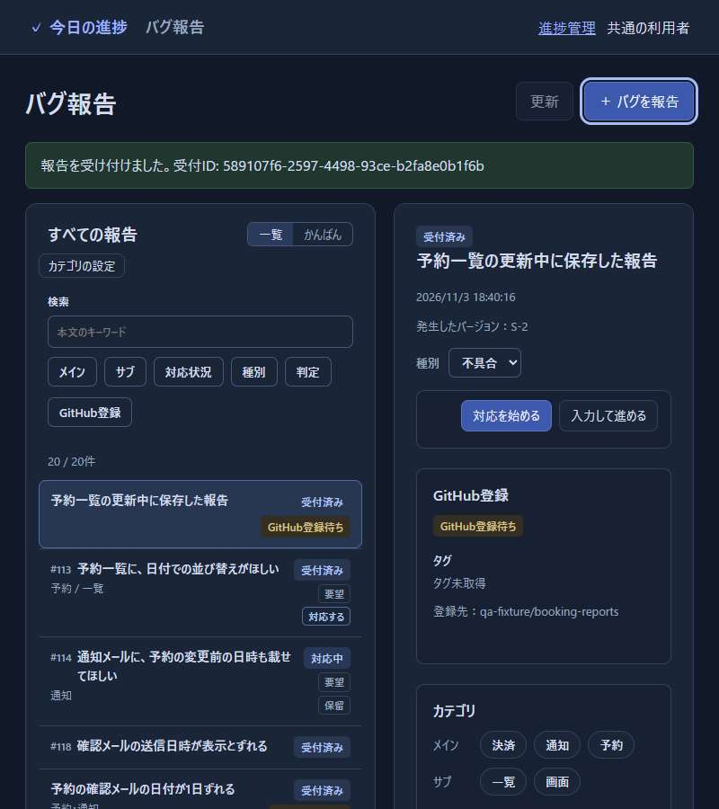
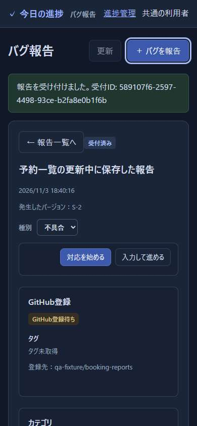
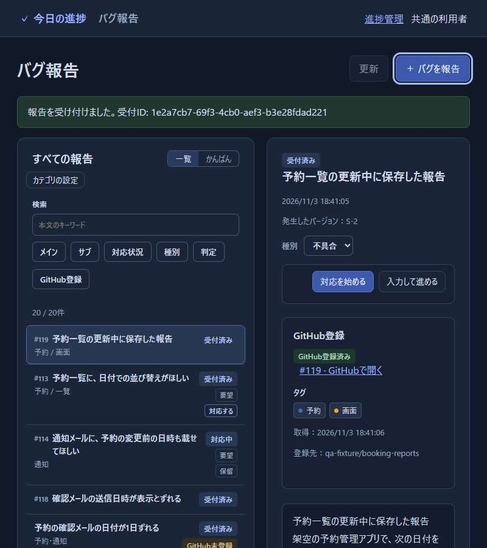
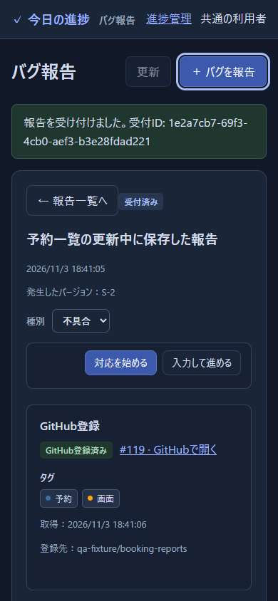

# タグ更新中の登録待ちの改善と検証

開発者が #65 の変更と確認範囲を判断するための記録である。
Codexが2026-11-03、main `f3937c0` と改善後の `0059ae8` を、架空の報告と模擬GitHubで比較した。
実際のGitHubの通信時間・ページング、実利用者の操作評価は対象外とする。

## 結果

タグ一覧の応答を2秒保留しても、新しい報告は応答前にGitHub登録を終えた。
50・250・500件の全条件で確認した。
500件では、保存から作成開始までが2,044.13msから1,013.86msになった。
残る約1秒は、登録ワーカーが次に動くまでの既存の待ち時間を含む。

| 登録済み報告 | 保存時間：前 / 後 | 作成開始まで：前 / 後 | 応答解放前の状態：前 → 後 |
| --- | --- | --- | --- |
| 50件 | 3.91 / 3.97ms | 2,012.90 / 1,006.89ms | 登録待ち → 登録済み |
| 250件 | 3.98 / 3.32ms | 2,020.26 / 1,008.27ms | 登録待ち → 登録済み |
| 500件 | 4.88 / 4.04ms | 2,044.13 / 1,013.86ms | 登録待ち → 登録済み |

登録待ちの確認は、各版・各件数で1回ずつ行った。
一覧の応答を解放する前のAPIの状態と、模擬GitHubへの作成要求の時刻を照合している。
保留時間を変えた一般的な速度向上率を、この結果から算出しない。

| 登録済み報告 | 一覧APIの中央値：前 / 後 | 初期画面の中央値：前 / 後 | 検索ありの更新の中央値：前 / 後 |
| --- | --- | --- | --- |
| 50件 | 7.81 / 7.83ms | 52.16 / 49.71ms | 62.78 / 64.52ms |
| 250件 | 35.66 / 35.14ms | 77.08 / 81.53ms | 100.50 / 103.04ms |
| 500件 | 76.71 / 77.40ms | 148.27 / 173.86ms | 203.51 / 194.43ms |

上表では模擬GitHubの応答を保留していない。
更新は、タグ保存、一覧・タグの役割・本文検索の取得、全件表示を含む。
初期画面や更新の時間には増減があり、一覧表示全体が速くなったという結果ではない。
500件の改善後のp95は一覧API 101.21ms、初期画面214.61ms、更新271.89msだった。
本文2,048文字ではこの測定値を残し、タグの役割と検索を並行取得する変更は今回に含めない。
長文時の検索の確認は [#64の記録](64-search-performance.md)で扱う。

環境、個別の測定値、要求順は[変更前のJSON](65-refresh-performance-before.json)と[変更後のJSON](65-refresh-performance.json)に保存した。
18組の標本から中央値・p95・最大値を再計算して一致を確認した。

## 変更と回帰検証

タグ取得の通信を登録処理の待ち行列から外した。
一括更新同士の順序を保ち、DBの確認と保存は登録処理と順番に行う。
取得中に更新されたタグや関連付けを古い応答で上書きしない。
動作条件の正本は[タグの表示と取得](../bug-reporting.md#タグの表示と取得)とする。

`tests/bug-github.test.mjs` に次の7件を追加し、関連56件、全体798件が成功した。

- 一覧の応答待ち中も新規登録が完了する。
- 一覧に載らないIssueの個別取得中も新規登録が完了する。
- 同時に要求された一括更新は順番を守り、その間も登録できる。
- 個別更新の新しいタグを、古い一覧や一覧取得の失敗で上書きしない。
- 取得中に接続先の関連付けが変わった報告を上書きしない。
- 取得中に判明した利用制限で、後続の個別取得と登録を待機させる。
- 終了時は実行中・待機中の一括更新を待ち、終了後にDBへ反映しない。

既存のブラウザ検証16項目、構文・画像検査も成功した。
実行結果は[検証JSON](65-refresh-verification.json)を参照する。

## 画面での確認

`tests/bug-screens-server.mjs` の架空の予約管理データを使い、同じ手順で比較した。
配置・文言は変更していない。

1. 一覧で「更新」をキーボードで実行し、模擬GitHubの一覧応答を保留する。
2. 「バグを報告」から本文と版を入れ、キーボードで送信する。
3. 6秒後にAPIと画面の登録状態を照合する。
   登録状態の画面への反映には、既存の5秒間隔の確認が使われる。
4. 幅800pxと390pxで状態・登録先を確認する。
5. 応答を解放し、次の更新では取得失敗を起こす。
   報告の入口が使えること、再更新で成功へ戻ることを確かめる。

### 変更前

タグの応答を待つ間は、詳細と一覧に「GitHub登録待ち」が残る。





### 変更後

「更新」が処理中のまま、詳細は「GitHub登録済み」と番号を表示する。
一覧にも番号と領域が反映され、登録待ちの印は消える。
必要な表示を保ち、新しい常設説明は加えていない。
幅390pxでも登録状態・番号・登録先が欠けずに読める。





キーボードで詳細から一覧へ戻り、同じ報告の選択が残ることも確認した。
行へフォーカスして詳細を再び開けた。
詳細を閉じたときのフォーカスの自動復元はmainにもない既存の制約で、今回の登録処理の変更には含めていない。
この確認はCodexのブラウザ操作であり、実利用者が迷わず操作できたという評価ではない。

## 再実行

[ブラウザ検証の設定](../development.md#ブラウザ検証)でPlaywrightとChromeの場所を指定する。
`QA_PRODUCT_ROOT` に比較するコードのフォルダー、`QA_ARTIFACT_DIR` に結果の保存先を指定する。
変更前のmainでは `QA_EXPECT_REGISTRATION=waiting`、改善版では `unblocked` を指定する。
既定はスクリプトを置いたリポジトリと `unblocked` である。

```sh
node tests/bug-refresh-performance.mjs
node tests/bug-refresh-browser-qa.mjs
npm test
npm run test:bugs:browser
npm run check
```

- 性能測定は、本文2,048文字の報告を50・250・500件用意し、条件ごとに一時DBを作る。
  一覧APIは23回中の最初の3回、初期画面と検索あり更新は各8回中の最初の2回を除く。
  ブラウザ幅は1280×900、検索語「予約」は全件に一致する。
- 中央値は昇順の中央2値の平均、p95は `ceil(標本数 × 0.95)` 番目とする。
  変更前後の測定は順番に行い、全体テストやほかのブラウザ検証と重ねない。
- 登録待ちはHTTP APIと既存の1秒間隔の登録処理を使う。
  一覧応答を保留し、新規保存から2秒後の状態を読んでから解放する。
- 画面検証は19件の架空データから始め、報告を1件追加する。
  ポート0で空きポートを使い、変更前後の画像をそれぞれ撮る。
- 各スクリプトはサーバー・ブラウザを閉じ、一時DBを削除する。
  実際のGitHubへ報告を書き込まない。

## 自己レビュー

確認範囲：Codexが `f3937c0` と `0059ae8` の製品・回帰テスト差分を読み、登録・再試行、タグ保存、利用制限、終了処理を確認した。
呼出元の `server/bug-api.mjs`、DBを閉じる `server.mjs`、通信を行う `server/bug-github-client.mjs`、保存を行う `server/bug-store.mjs`、画面の更新と登録状態の確認を行う `dist/bugs/app.mjs` を追った。
測定・画面検証スクリプト全体と、仕様書全体、API仕様のGitHub登録・登録情報の節、画像とUIレビューの規則も照合した。

指摘と修正：一覧取得失敗時に「全報告が失敗」としていた文を、取得中に別の更新があった報告の保護と整合させた。
測定スクリプトは製品版とワーカーのハッシュを記録し、応答待ちを検索入力前に設定して取りこぼしを防いだ。
変更前後の測定と画面確認、保存した標本の再集計で再確認した。
今回の変更に修正必須の指摘は残っていない。

未確認の範囲：実GitHubの複数ページの通信、実際の利用制限、複数端末での負荷、長文条件、実利用者の受入。
利用制限の共有と同時更新・終了は模擬応答で確認したもので、外部サービスの実測とは分ける。
登録自体の通信時間や、すでに始まった登録処理を中断する機能は変更していない。
