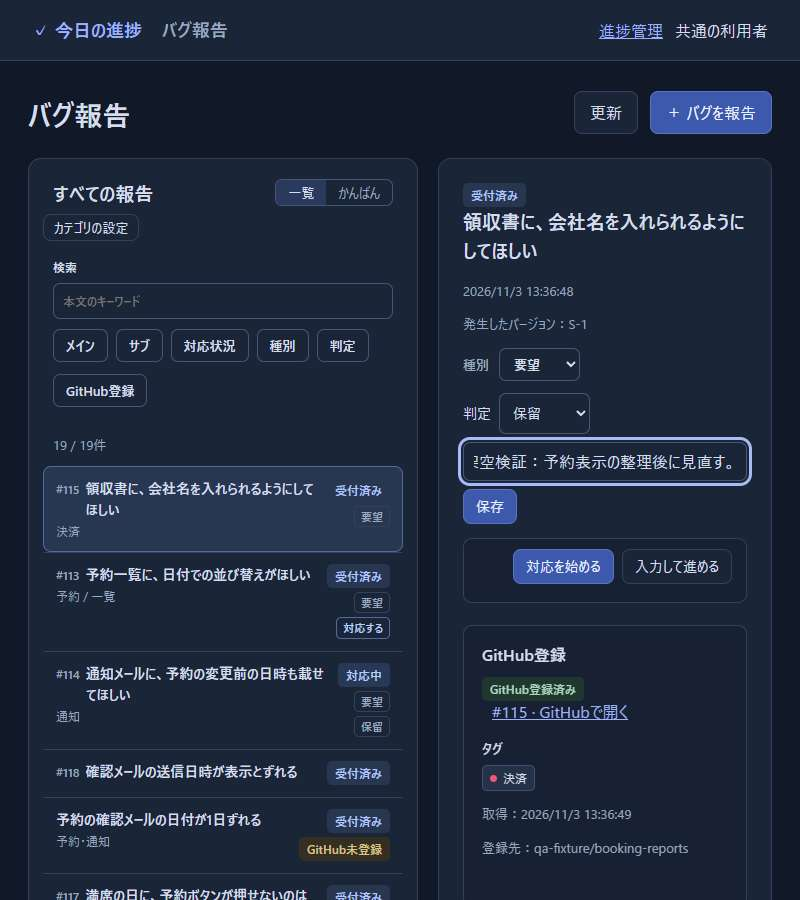
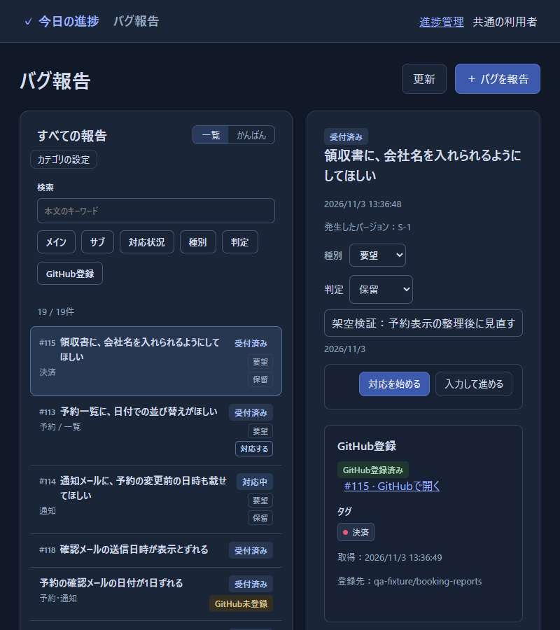
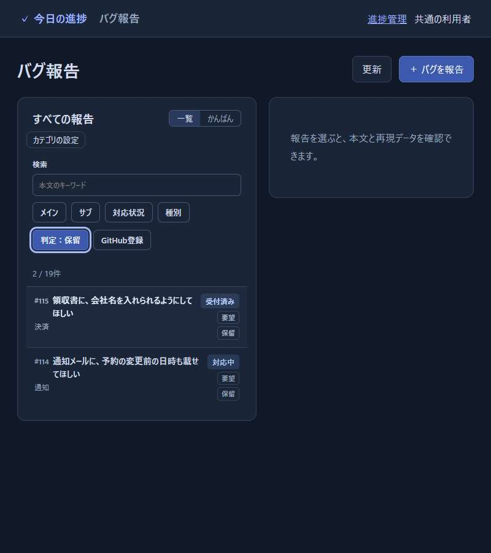
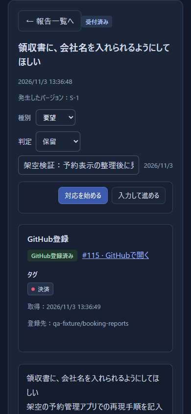

# バグ一覧と要望判定の検証・受入記録

Wakuaが #62 と #82 の成果を判断するための、2026-11-03の検証記録である。
対象はmain `e65878a`、v0.3.0。
Wakuaは本記録の検証結果と保存直後の画面を確認し、2026-11-03に両件を受け入れた。
担当と現在の進行は各Issueと[Project 3](https://github.com/users/Wakua/projects/3)で管理する。

## 一覧と絞り込みの自動検証（#62）

[PR #119](https://github.com/Wakua/github-progress-board/pull/119)は2026-10-30にマージされ、検証はmainに含まれる。
同日14:14 JST、Wakuaの「両方マージしたからこれで進められるか？」という発言を、Codexチャット `01a182ca-4fc1-7301-b8b6-abbdbf42ce7d` で確認した。
この回答は #118・#119 のマージの確認であり、マージ後の個別受入としては記録されていない。

Codexが環境同梱のPlaywrightとChromeで `npm run test:bugs:browser` を再実行し、16項目の成功とJavaScriptエラー0件を確認した。
一覧・本文検索・メイン／サブ・未分類・検索失敗後の復帰・再読込み・幅390pxの操作を含む。
項目ごとの結果は[実行結果](62-main-browser.json)を参照する。
架空の予約管理報告、一時DB、模擬GitHubのみを使用した。

## 要望の判定（#82）

Claudeの[PR #109](https://github.com/Wakua/github-progress-board/pull/109)は2026-10-17にマージされた。
同日14:44 JST、Wakuaの「#109を承認します」をClaudeの作業記録で確認した。
その後の同チャットでは個別受入を求めており、今回確認したIssue・PR・会話にはその回答がない。
実装や採用済みの4点を再提案せず、残っていた保存後の画面を確認した。

`tests/bug-screens-server.mjs` の架空データ19件で、CodexがChromeを操作した。
人の行動観察とは区別する。
検証時のサーバーはloopbackの別ポートを使い、実際のGitHubへは送信していない。

1. 「領収書に、会社名を入れられるようにしてほしい」を開き、未判定から保留へ変更し、理由を入力した。
2. 保存を押すと、保留・理由・判定日が表示され、保存ボタンが消えた。
   対応状況は受付済みのままだった。
3. 再読込み後も値を保持し、APIの値とも一致した。
4. 一覧の「判定」で保留を選ぶと、保存した報告と既存の保留報告の2件だけになった。
5. 幅390pxで同じ詳細を開き、横あふれなく表示された。
   一覧へ戻ると絞り込みが保持された。

判定のAPI・画面テスト15件も成功した。
[ブラウザの実行結果](82-main-decision.json)に対象版と結果を記録した。

保存前（幅800px）：

保存直後（同じ幅・同じ報告）：

保留の絞り込み：

狭い画面の詳細：

## 受入と確認範囲

- #62：現行mainのブラウザ検証16項目を提示し、Wakuaが「受け入れる」と回答した。
- #82：保存直後・再読込み・保留の絞り込みの結果と画面を提示し、Wakuaが「受け入れる」と回答した。

回答元はCodexチャット `01a19faf-235c-7383-8ab2-4869c5f301c8`。
両件の受入対象はv0.3.0、main `e65878a` である。
過去のマージ承認を受入へ読み替えず、今回の回答を記録した。

技術的な再検証をWakuaへ依頼するものではない。
キーボードのみの操作、スクリーンリーダー、非常に長い理由、実利用者の操作は今回の確認範囲に含めない。
実運用の拡大は #16、実データのまとめの登録は #69 で扱う。

## 記録の自己点検

確認範囲：上記main、#62・#82の本文とコメント、#119・#109の本文とマージ記録、過去の回答、`docs/bug-reporting.md` の要望の判定を照合した。
指摘：Issue本文の未実装の記載は現行mainと一致しないため、現在の成果と残る判断へ更新する。
本記録には仕様を再定義せず、実施した操作と結果を記載した。
未確認の範囲：上記に示したアクセシビリティと実利用者の操作は未検証である。
